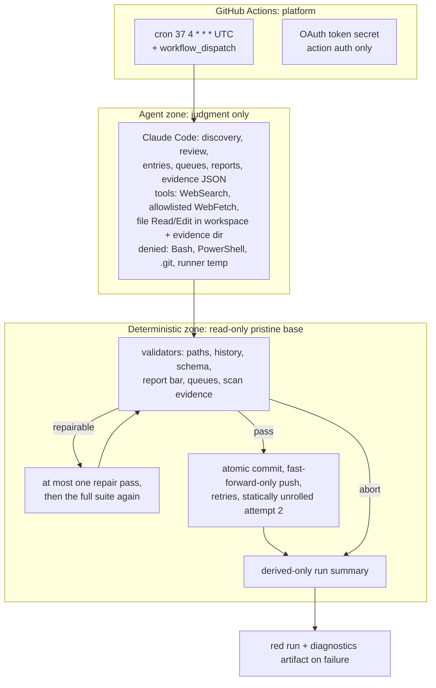

# HDAI-AIRADAR-001: baseline agentic-engineering handover from ai_radar

**Reader:** a coding agent that has never seen this project and will turn its lessons into a generic Agentic Engineering Playbook.

**How to read the evidence tags.** Every claim cites a repository path or commit hash. Four tags mark claims where the difference matters:
- **[implemented]**: it exists in code or config at `10bdbc4`.
- **[intended]**: planned or recorded as a decision, but not built.
- **[measured]**: counted from files, git history or the GitHub Actions API on 2026-10-14.
- **[interpretation]**: the author's or this handover's reading of the evidence.

**Squashed history.** The public git history starts at `35c3cfc` ("ai_radar: public debut", 2026-08-12). It was squashed, so commits cited inside the plans from before that date (for example `59070c0`) cannot be checked in this repository. For that period, the dated documents under `docs/` are the evidence.

---

## 0. Summary

1. ai_radar is a personal research radar. Two Claude Code skills share one engine. Each day they find public material on AI economics and AI engineering, check it against the source, and archive it as structured markdown entries (`README.md`, `CLAUDE.md`).
2. The design rule: **the model does the judging, and deterministic code enforces the guarantees** (`README.md`; `docs/plans/2026-07-23-001-feat-unattended-daily-radar-plan.md`, Key Technical Decisions).
3. A GitHub Actions harness runs the agent with no shell, no git, and web fetches limited to an allowlist. It then validates everything the agent wrote from a read-only copy of the base commit, and only the harness commits (`.github/workflows/radar-daily.yml`, `scripts/build_claude_settings.py`).
4. v1 (built by hand, no scripts) shipped on 2026-07-22. v2 (unattended) went live on 2026-07-23, and its pilot closed as successful on 2026-09-01 (`CHANGELOG.md`).
5. [measured] Scheduled runs since the public debut: 55 of 63 succeeded (16/20 during the pilot, 39/43 after it). All 8 failures were loud red runs with no commit, so no day passed silently.
6. [measured] The library holds 307 entries, all `accepted`, with 0 provisional. There are 71 daily reports per domain. 52 of the social-science reports and 42 of the AI-engineering reports are honest quiet days.
7. Every failure class so far was a **specification or harness defect**, and the guardrails caught each one before it corrupted anything (`docs/ops/*.md`).
8. Strongest reusable lessons: certify on the production trigger; give a headless agent a completion contract; run validators from a pristine copy the agent cannot touch; queue undecidable items for a human instead of guessing; never combine a grow-only rule with a length cap.
9. [measured] The weakest loop is the outer loop. No human has resolved a review-queue record since 2026-08-12, and 19 records are pending. Four failed runs after the pilot have no write-up. One of them (2026-09-27) repeats the 2026-08-07 queue deadlock.
10. [measured] The pilot evaluation's queue counts included the commented example records in the queue files. The true count of pending records at pilot close was 14, not 18 (section 14).
11. Open items: four engine changes deferred at the pilot review, the cron drift decision, measuring cost per run, stale status markers, and the OAuth token renewal (~2027-06).
12. Use this file as the baseline. Weekly delta handovers follow the format in `docs/hdai/README.md`.

---

## 1. The system in one page

**What it does.** Two skills, `social-science-radar` and `ai-engineering-radar`, carry only domain identity: a description, pointers to their profiles, and the audience voice (`.claude/skills/*/SKILL.md`). Both follow one engine (`engine/ENGINE.md`, procedures P1–P8) and one entry schema (`engine/schema.md`). Each candidate gets exactly one of four dispositions: archive, merge/link, keep as provisional, or reject (`engine/ENGINE.md` P3). The product is the library (`library/entries/`, `library/INDEX.md`, `library/rejections.md`). Daily reports (`reports/<domain>/daily/`) are a filtered view of it and never a second source of truth (`CLAUDE.md`).

**Three ascending bars** decide what gets through (`engine/ENGINE.md`, "The three bars"):
1. Discovery bar: medium relevance or better, to enter review.
2. Library bar: the review judgment.
3. Report bar: accepted, verified, high relevance, and a practical implication. At most 3 report items per day.

**Architecture and trust zones** [implemented] (`.github/workflows/radar-daily.yml`; plan diagram "Trust and enforcement boundaries"):

**Where agents act and where code acts**

| Step | Who does it | Evidence |
|---|---|---|
| Discovery, relevance scoring, verification against the source, choosing a disposition, writing entries, reports and queue records | Agent (Claude Code) | `engine/ENGINE.md` P1–P8 |
| Turning the egress allowlist into permission rules | Script | `scripts/build_claude_settings.py` |
| Allowed write paths, append-only history, preserving entry bodies, report date discipline | Validator | `scripts/validators/check_changed_paths.py` |
| Entry schema and agreement with INDEX | Validator (repairable) | `scripts/validators/check_library_consistency.py` |
| Report bar, entry links, quiet-day statement plus evidence | Validator | `scripts/validators/check_report_integrity.py` |
| Queue shape, controlled vocabularies, metadata-only length limits | Validator (repairable) | `scripts/validators/check_queue_records.py` |
| A scan-evidence JSON exists and is well formed | Validator (abort) | `scripts/validators/check_scan_evidence.py` |
| Commit, push, retry, classifying the outcome | Script | `scripts/run_delivery.py` |
| Safe run summary and facts about the model run | Script | `scripts/make_run_summary.py`, `scripts/summarize_execution_log.py` |
| Clean working tree before an interactive run | Validator | `scripts/validators/check_clean_base.py` |
| Resolving queue records, promoting sources, editing the engine, profiles or allowlist | Human only | `CLAUDE.md`; `engine/ENGINE.md` Unattended mode |

---

## 2. Timeline

| Phase (dates) | What happened | Key evidence | Agentic-engineering lesson |
|---|---|---|---|
| **v1 build**, 2026-07-22 | Requirements, then a plan with 8 units (U1–U8), each ending at a user checkpoint. No scripts: the engine is markdown conventions the agent follows. 25 entries at release. | `docs/brainstorms/2026-07-22-ai-radar-requirements.md`; `docs/plans/2026-07-22-001-feat-ai-radar-v1-plan.md`; `CHANGELOG.md` v1.0.0 | Prove the agent's judgment by hand before automating. Keep skills thin and put shared mechanics in one engine. |
| **v2 design and build**, 2026-07-23 | 38 origin requirements plus 12 added in the plan (R39–R50). A five-persona document review. A feasibility and governance gate (U1) that sorts each claim into fact, assumption, risk or open question. Validators with 136 tests. Rollout stages 1 and 3–7 with live security probes. The schedule activated the same day. | `docs/brainstorms/2026-07-23-unattended-daily-radar-requirements.md`; plan R39–R50; `docs/ops/2026-07-23-v2-feasibility.md`; `docs/ops/v2-rollout-runbook.md` | Get human approval before any credential or schedule exists. Prove each guarantee with a drill, not with documentation. |
| **First live fires**, 2026-07-24 to 07-28 | Five failures in a row, in three classes: A (subscription usage limit), B (the delivery gate used `inputs.mode`, which is empty on scheduled runs), C (the model stopped right after reading its instructions). B fixed and the schedule moved to UTC 04:37 on 07-27. The completion-contract prompt, a bounded retry and safe run facts landed on 07-28. | `docs/ops/2026-07-27-scheduled-delivery-incident.md`; `docs/ops/2026-07-28-model-bail-review.md` | Certify on the production trigger. Prompts need a definition of done. GitHub cron runs in UTC only. |
| **Pilot extension and first human review**, 07-29 to 08-12 | Four successful runs in a row. The 07-31 human review found that summariser paraphrases had been treated as sources, that large PDFs cannot be read, and that the watchlist had a blind spot for vendor research. Four validation aborts (08-01, 08-02, 08-05, 08-07) were traced to three specification defects and fixed on 08-12. | `docs/ops/2026-07-31-pilot-learnings.md`; `docs/ops/2026-08-12-validation-abort-review.md` | Templates, instructions and validators must agree with one another. A grow-only rule plus a length cap deadlocks. A human review finds what green runs cannot. |
| **Public debut**, 2026-08-12 to 08-13 | History squashed and published. PDFs under `inbox/` gitignored. A YAML quoting fix in a skill description. | `35c3cfc`, `42ce1a6`, `6c8104a` | Check the information boundary before publishing. Unquoted `: ` in YAML frontmatter breaks GitHub's rendering. |
| **Public pilot and close**, 08-13 to 09-01 | 16/20 scheduled runs succeeded. Background-agent delegation was banned, evidence was required before reports, push retries were added (`03189dc`), cron drift was documented (`db438b0`), the pilot closed (`99cb429`), and the acceptance trace was recorded (`437a54d`). | `docs/ops/2026-09-01-pilot-evaluation.md`; `docs/ops/2026-09-01-github-cron-drift.md` | A headless agent must not delegate to background workers. Write the completion artifact first. Push races are real. |
| **Steady state**, 09-02 to 10-14 | 39/43 scheduled runs succeeded. Four `validation` failures (09-10, 09-11, 09-12, 09-27) with no write-up and no recovery run. A presentation (`3da5fdc`, `3933d8e`). Two manual ingests (`fdb04c7`, `ddacd85`). No queue triage. | [measured] GitHub Actions run list; report gaps in `reports/*/daily/` | Without a cadence and an owner, the outer loop stalls. Diagnostics expire after 30 days, so untriaged failures lose their evidence. |

---

## 3. Context engineering

| Artifact | What it carries | What it taught |
|---|---|---|
| `CLAUDE.md` (project operating contract, auto-loaded) | Purpose, information boundary, a five-question self-check before every write, architecture rule, conventions, workflow checkpoints | One always-loaded contract keeps the boundary rules in force across sessions. The run prompt says not to re-read it because it is already in context (`.github/prompts/daily-radar.md` step 1). |
| `engine/ENGINE.md` | Procedures P1–P8, the three bars, an "Unattended mode" section that turns "stop and ask" into "defer and continue" | Shared behaviour belongs in one file. Every fix during the pilot applied to both domains at once (`docs/ops/2026-07-31-pilot-learnings.md`, Learning 9). |
| `engine/schema.md` plus `engine/templates/*.md` | Entry frontmatter (status, verification, relevance per domain, canonical ids), formats for the four dispositions, dedup rules | A template is executable context: the agent copies it exactly. A placeholder spelling in the template that the validator did not accept caused three discarded days (`docs/ops/2026-08-12-validation-abort-review.md`, root cause 1). |
| `.claude/skills/*/SKILL.md` | Trigger description, domain tag, profile pointers, audience voice. Rules are referenced, not restated. | The description is the skill's API signature (`docs/plans/2026-07-22-001-feat-ai-radar-v1-plan.md`, Skill Design Primer). Both skills still say "pending activation" (gap, section 12). |
| `profiles/<domain>/profile.md` | Eight relevance lenses per domain plus rules for each tier | Scoring changes only when this file changes. A recall gap (vendor research labs) was a profile defect, not a model defect (Learning 12). |
| `profiles/<domain>/sources.md` | Curated watchlists, checked before open search | Watchlists organised around institutions miss first-party corporate research by construction (Learning 12). |
| `profiles/egress_allowlist.md` | 56 exact-host domains the unattended run may fetch from [measured by running `build_claude_settings.py`] | Exact-host matching causes recurring misses, such as `www.` variants and subdomains. The fix is human allowlist maintenance plus a deferral queue, not wildcards (Learning 5). |
| `.github/prompts/daily-radar.md` (run prompt) | "No one will ever reply", a three-condition definition of success, a ban on delegation, ordering with evidence before reports, allowed paths | A task list without a terminal condition lets the model stop at the boundary between reading and acting (`docs/ops/2026-07-28-model-bail-review.md`). |
| Repair prompt (inline in the workflow) | "Fix only those findings. Change nothing else." plus the path to the violations file | Repair prompts follow the shortest-looking fix. On 08-07 and again on 09-27 the repair shortened a grow-only field and turned a repairable violation into an abort (section 8). |
| Scan-evidence JSON (`$RADAR_EVIDENCE_PATH`) | Counts of curated sources fetched and queries run, per domain | A machine-readable proof of work makes "quiet day" checkable. Whether the counts are true remains an accepted residual risk (plan R39). |
| Scan notes in reports | Which sources loaded or failed, and why | [interpretation] More useful for diagnosis than the reports themselves (Learning 6). |
| Agent memory (local, outside the repository) | Session handoff state, operational reminders | A next step held only in memory (queue triage on 2026-09-02) did not happen (section 9). |

---

## 4. Harness engineering

**Run-time constraints** [implemented]
- **Tools:** WebSearch, WebFetch only for allowlisted domains, and Read/Edit in the workspace and the evidence directory. `Bash` and `PowerShell` are denied by bare name, which removes them from the model's context. `.git/**` and runner temp, where the GitHub control files live, are denied (`scripts/build_claude_settings.py`).
- **Credentials:** `persist-credentials: false` on every checkout of the model workspace. The push token exists only in delivery steps (`.github/workflows/radar-daily.yml`; plan R49).
- **Auth boundary:** the job fails if `ANTHROPIC_API_KEY` is present. The model is reached only through the subscription OAuth token (`radar-daily.yml`, step "Guard auth boundary"; `docs/ops/2026-07-23-v2-feasibility.md`, "Authentication boundary").
- **Pristine base:** the base commit is cloned into a harness directory, copied, and made read-only with `chmod -R a-w`. All scripts that run after the model, and all git operations, run from there. Copies in the workspace are inert (plan R41; `test_run_delivery.TestValidate.test_tampered_workspace_scripts_are_inert_and_flagged` cited in the runbook, stage 1).

**Validators** [implemented]
- Python standard library only. Exit codes: 0 pass, 1 violation, 2 internal error, and 2 fails closed. Two violation classes, `ABORT` and `REPAIRABLE`.
- **No-echo rule:** violation messages are built only through `lib_radar.emit()`, which has no free-text parameter. Unsafe slot values and path segments are redacted (`scripts/validators/README.md`).
- 177 tests in 12 test files [measured; run on 2026-10-14: `Ran 177 tests ... OK`].

**Gates** [implemented]
- At most one repair pass per attempt, followed by the complete validator suite again (plan R42).
- Attempt 2 is statically unrolled. It runs only when the push is rejected or for the exact "degenerate" signature: the model succeeded, but the only violation is `EVIDENCE_MISSING` (`radar-daily.yml`; `docs/ops/2026-07-28-model-bail-review.md`).
- An empty diff counts as success only when the scan evidence is valid and today's reports already exist (plan, Key Technical Decisions).
- The outcome gate fails the job on any result other than `success` or `no-change` (`radar-daily.yml`, step "Enforce run outcome").

**Allowlists**
- Egress: `profiles/egress_allowlist.md`, human-controlled. The run never extends it.
- Writes: `library/entries/`, `INDEX.md`, `rejections.md`, today's reports, `reviews/` (`.github/prompts/daily-radar.md` step 5, enforced by `check_changed_paths.py`).

**Sandbox and permission findings**
- [measured] Live probes in run 30022444070: reading git config was denied, shell was denied, reading runner temp was denied, and an off-allowlist fetch was denied (runbook, stage 6).
- The official action rewrites the workspace's git remote with an app token. This was contained by the `.git/**` deny and the absence of a shell (runbook, stage 4).
- `WebFetch(domain:…)` matches the exact host only (runbook, stage 4b).
- GitHub ignored the cron `timezone:` key in practice, although the docs stated support for it (`docs/ops/2026-07-27-scheduled-delivery-incident.md`).
- Branch protection is unavailable on the free plan for private repositories, so the validators were the only guard on `main` (`docs/ops/2026-07-23-v2-feasibility.md`, gate 8).
- In this interactive session: `git fetch` and `gh` needed the sandbox network allowlist or a sandbox bypass, and `python3` through `xcrun` failed inside the macOS sandbox. Calling the Command Line Tools Python directly worked (observed while writing this handover).

**Tooling that works**
- `workflow_dispatch` with the modes `dry-run`, `no-push` and `full` for graduated rollout and recovery (plan R45).
- `concurrency` with `cancel-in-progress: false`.
- A derived-only job summary, which is safe to read in logs.
- `model-run-facts.json` (tool counts and termination facts without transcript content) for diagnosing model stops (`scripts/summarize_execution_log.py`).

**Tooling that fails or misleads**
- GitHub cron: UTC only, best effort. From 2026-08-27 to 2026-09-01 it fired 5–12 h late (`docs/ops/2026-09-01-github-cron-drift.md`). [measured] After the pilot, fires started at 08:32–12:21 UTC against a 04:37 slot.
- The fetch tool cannot ingest large PDFs, such as a 13 MB, 100-page report (Learning 11).
- Diagnostics artifacts are kept for 30 days. The artifacts of the 09-10, 09-11 and 09-12 failures had expired by 2026-10-14 [measured: `gh run download` found no valid artifacts].
- `check_clean_base.py` does not fetch, so a stale checkout passes (section 9).

---

## 5. Loop engineering

| Layer | What exists | Gap |
|---|---|---|
| **Feedforward guides** | `CLAUDE.md` contract; `engine/ENGINE.md` procedures; `engine/schema.md` and templates; profiles with tier rules; closed vocabularies for queue reason classes and statuses (`engine/templates/deferred-candidate.md`); egress allowlist; run prompt with a completion contract | P2.2 still says "trace … back to the source text" and does not say the *retrieved* text, not a summary (`engine/ENGINE.md` P2; Learning 10, change deferred). Both profiles still carry a "Strawman draft — edit me" banner, so the reader cannot tell whether the human edit pass happened. |
| **Fast sensor run by the agent** | Interactive runs: `check_clean_base.py` is the first step (`engine/ENGINE.md`, Skill contract). Unattended runs: the agent does **not** run validators itself, because it has no shell. It must check the three success conditions before it ends its turn (`.github/prompts/daily-radar.md`). | [interpretation] The agent cannot get deterministic feedback inside its own run. Errors surface only after it stops, and then there is one repair pass. Exposing validators as a read-only tool the agent can call is the obvious next step, but it would widen the tool surface. This is a design decision for the human. |
| **Interpretation sensors** | Dedup against INDEX, rejections and both queues; cross-domain scoring against both profiles (`engine/ENGINE.md` P2.3–P2.4); the report bar checked mechanically for status, verification and relevance (`check_report_integrity.py`) | No deterministic check that a summary is faithful to its source, and no check of consistency across sources. Dates are checked in queues only. Scan-evidence counts are self-attested by the agent (plan R39, accepted risk). |
| **Slower independent sensors** | Validators run from a pristine copy the agent cannot modify (independent of the agent, but not a second model). Human review on 2026-07-31 and on 2026-08-12 (queues cleared). Manual acceptance trace on 2026-09-01. Five-persona document review at planning time (plan, Sources/Research). | No second-model reading of entries. A second human reader was planned in the 07-31 extension (Learning section 9, item 1), but no record shows it happened. No sampled spot-check cadence. |
| **Outer loop** | Every incident has a dated write-up in `docs/ops/`, and its fixes landed as validators, tests or prompt rules. Examples: `test_delivery_gate_covers_scheduled_runs` (07-27), `TestRuntimePrompt` (07-28), both placeholder spellings plus the 240-character append rule (08-12), the delegation ban plus evidence-first ordering (09-01). Human queue resolutions are an append-only audit trail (`reviews/`). | Stalled since 2026-09-01. Four failed runs have no write-up, 19 queue records are pending, and nothing was resolved after 2026-08-12 [measured]. The 08-12 fix for the queue deadlock was an instruction only. It recurred on 09-27 in the repair pass. No automated "disagreements to a to-do list" step exists. |
| **Loop metrics** | Success rate of scheduled runs, quiet-day share, provisional count, queue sizes, run duration (`docs/ops/2026-09-01-pilot-evaluation.md`; `docs/ops/2026-07-31-pilot-learnings.md` §7) | Metrics are computed by hand in prose, and one count was wrong (section 14). Not measured: model cost per run, repair-pass acceptance rate, agreement rate between agent and human on deferred items, and time to resolve queue items. |

---

## 6. Design decisions and their reasons

| Decision | Date | Reason | Record |
|---|---|---|---|
| Two thin skills over one shared engine | 2026-07-22 | Prevents drift by construction. A new domain needs only a profile. | `CHANGELOG.md` v1.0.0; v1 plan, Key Technical Decisions |
| The library is the product; reports are a filtered view | 2026-07-22 | One source of truth; every report item traces to an entry and then to its source | `CLAUDE.md`; `CHANGELOG.md` v1.0.0 |
| No scripts in v1 | 2026-07-22 | Understand the workflow by hand before automation hides it | v1 plan, Skill Design Primer |
| State is derived from artifacts; no state files | 2026-07-22 | Nothing can drift out of sync | `engine/ENGINE.md` header; `CLAUDE.md` Conventions |
| Append-only Updates; text above `## Updates` never changes | 2026-07-22, tightened 2026-08-12 | Traceability over the entry's life; the validator can enforce it | `engine/schema.md`; `docs/ops/2026-08-12-validation-abort-review.md` fix 2 |
| Authenticate with subscription OAuth only; never an API key | 2026-07-23 | Cost control and governance; structurally checkable | `docs/ops/2026-07-23-v2-feasibility.md`, Authentication boundary |
| Egress Option A: exact-host allowlist; unknown domains are deferred | 2026-07-23 | Closes the read-plus-fetch exfiltration channel at the cost of breadth | feasibility doc, Egress decision |
| Validators run from a read-only pristine base | 2026-07-23 | The agent cannot grade or rewrite its own judge | plan R41 |
| Claude never touches git | 2026-07-23 | Commit authority is enforced by configuration, not instruction | plan, Key Technical Decisions; R48/R49 |
| A "deferred" state instead of guessing when unattended | 2026-07-23 | No user is present; a boundary doubt never resolves in favour of inclusion | `engine/ENGINE.md`, Unattended mode |
| Second attempt statically unrolled, at most 2 | 2026-07-23 | Actions steps cannot loop back to an action | plan, Key Technical Decisions |
| Graduated 9-stage rollout with recorded evidence | 2026-07-23 | Each stage disproves one failure class while the blast radius is small | `docs/ops/v2-rollout-runbook.md` |
| Cron declared in UTC 04:37; `timezone:` removed | 2026-07-27 | The key was ignored live; the run should finish before the working day | `docs/ops/2026-07-27-scheduled-delivery-incident.md` |
| Completion-contract prompt plus a bounded retry for the degenerate signature | 2026-07-28 | Model stops at the read/act boundary | `docs/ops/2026-07-28-model-bail-review.md` |
| Raw transcripts are never uploaded | 2026-07-28 | They contain fetched content | same |
| Walled sources (LinkedIn) retired, not kept as provisional | 2026-07-31 | They can never be verified | `library/rejections.md` rows dated 2026-07-31 |
| Queue appends share the 240-character budget; when they do not fit, bump the date only | 2026-08-12 | Breaks the deadlock between grow-only and the length cap (at instruction level) | `engine/ENGINE.md`, Deferral procedure |
| Background-agent delegation banned; evidence before reports | 2026-09-01 | Delegated work died when the turn ended | `03189dc`; `.github/prompts/daily-radar.md` |
| Failure-only notifications (R38); keep `full` dispatch (R45) | 2026-09-01 | Success is the norm; `full` is the recovery path | `docs/ops/2026-09-01-pilot-evaluation.md` §6 |

---

## 7. Reusable playbook

Each rule is written for any project first, then followed by this project's instance.

**P1. Give judgment to the model and guarantees to code.**
- *Rule:* Each invariant you must be able to rely on is enforced by a deterministic component outside the agent's control. The agent is trusted only for judgment.
- *Why:* Five distinct failures in the first week caused zero library corruption, because Python validators, not model behaviour, contained them (`docs/ops/2026-07-31-pilot-learnings.md` §3.1–3.2).
- *How to apply:* List the invariants. For each one, name the deterministic owner (validator, permission rule, harness step). If an invariant has no owner, it is a hope, not a guarantee.
- *How to check:* An ownership table maps every requirement to an enforcer (plan, "Component ownership" and traceability matrix). Each enforcer has a negative test.

**P2. The judge must be unreachable by the agent.**
- *Rule:* Run validators, delivery and summary scripts from a read-only copy of the base commit, and use a git directory the harness owns.
- *Why:* Otherwise the agent could edit the validator that grades it. Flow analysis and document review both flagged this as the self-judging hole (plan R41).
- *How to apply:* Materialise a pristine copy before the agent step and make it read-only. Never execute a script from the agent's workspace.
- *How to check:* A tamper drill: plant a modified validator in the workspace and confirm it is inert and flagged (`test_run_delivery…test_tampered_workspace_scripts_are_inert_and_flagged`).

**P3. Least privilege by configuration, certified by live probes.**
- *Rule:* Remove tools from the agent instead of instructing it not to use them. Then prove the removal with probes on the real platform.
- *Why:* The design thesis held: soft guidance drifted in attempt 2 of a drill, while hard rules held (runbook, stage 6). The live probes showed denied access to git config, shell, runner temp and off-allowlist fetches.
- *How to apply:* Deny the shell by bare name, deny `.git/**` and control files, put egress on an exact-host allowlist generated from one human-owned file, and use no persisted credentials.
- *How to check:* Run probe steps inside a real run and record the results. Re-probe after any change to the workflow.

**P4. A headless agent needs a completion contract and a completion artifact.**
- *Rule:* State what "done" means as conditions the agent can check. Require an artifact that proves the work happened. Treat a missing artifact as a hard failure on every path, including "nothing changed".
- *Why:* The model twice stopped cleanly after 30–43 turns with zero fetches, because the prompt had a task list but no terminal condition (`docs/ops/2026-07-28-model-bail-review.md`).
- *How to apply:* Open the prompt with "nobody will reply; a response without a tool call ends the run" and a short success definition. Add a verify-before-ending step. Write the evidence artifact *before* the deliverables, so a run that dies leaves evidence rather than orphan outputs (`03189dc`).
- *How to check:* Track the rate of the degenerate signature: a run that ended with "success" but has no artifact (`validate` emits `degenerate=true`).

**P5. Certify on the trigger you will use in production.**
- *Rule:* Before declaring the system ready, exercise at least one full run on the real production trigger.
- *Why:* Every rollout drill used `workflow_dispatch`. On `schedule`, `inputs.mode` is empty, so delivery never fired, and two complete correct scans were discarded (`docs/ops/2026-07-27-scheduled-delivery-incident.md`).
- *How to apply:* Gate on step outputs or event names, never on inputs that exist for only one trigger. Add a structural test for each trigger.
- *How to check:* `test_workflow_structure.test_delivery_gate_covers_scheduled_runs`. The first production-trigger run is reviewed by hand.

**P6. Defer, don't guess.**
- *Rule:* When an unattended agent cannot safely decide, it writes a metadata-only record to a human queue and continues. Only humans resolve records, and resolved records stay as an audit trail.
- *Why:* Unreachable domains, provenance doubts and possible duplicates come up almost daily. Guessing would corrupt the library, and stopping would lose the day (`engine/ENGINE.md`, Unattended mode; Learning 5).
- *How to apply:* Use closed vocabularies for reason classes and statuses, dedup records across queues, and keep records metadata-only with a length limit.
- *How to check:* Watch queue inflow against resolution and the age of the oldest pending record. *This project fails this check* (section 5, outer loop).

**P7. Fail closed and loudly; prefer producing nothing to producing something wrong.**
- *Rule:* Any validator crash or abort-class violation withholds the commit and turns the run red with diagnostics.
- *Why:* [measured] 0 silent days across 63 public scheduled runs. Every missing report day matches a red run.
- *How to apply:* Exit code 2 means abort. An outcome gate fails the job on any result other than success or no-change.
- *How to check:* Every calendar day maps to either a delivered artifact or a red run (DoD item 5 in the plan).

**P8. One specification feeds template, instruction and validator.**
- *Rule:* A placeholder, format or rule that the agent writes and a validator checks must be defined once and tested in both directions.
- *Why:* The template wrote `None yet.`, but the validator exempted only `*(none yet)*`. Every legitimate merge looked like a body rewrite, and three days were discarded. `schema.md` also asked for an edit the validator forbids (`docs/ops/2026-08-12-validation-abort-review.md`).
- *How to apply:* Generate validator constants from the template, or add a test that renders the template and runs the validator on the result.
- *How to check:* A fixture test copies the current template, applies each permitted disposition, and expects zero violations.

**P9. Never combine a grow-only rule with a length cap; fix structural deadlocks structurally.**
- *Rule:* If a field must only grow, it cannot also have a hard maximum, unless an explicit "no more appends" state exists and the validator accepts it.
- *Why:* On 08-05 and 08-07, re-encounter appends passed 240 characters. The repair pass then shortened the text and turned the violation into an abort. The 08-12 fix was an instruction ("bump the date only"). The same pattern recurred on 2026-09-27 (run 36311658264: `QUEUE_TEXT_TOO_LONG` and `QUEUE_RECORD_REWRITTEN`).
- *How to apply:* Make the validator accept a date-only bump as valid when the field is at the cap, and tell the repair prompt that shortening is never a fix. Better still, store re-encounters as separate dated lines.
- *How to check:* A fixture with a field at the cap plus a re-encounter passes validation without any text change.

**P10. Diagnostics carry derived facts, never content.**
- *Rule:* Logs, summaries and violation messages identify file, line and rule only. Raw transcripts are never uploaded.
- *Why:* Fetched web content can be adversarial or boundary-sensitive (plan R43/R47; transcript upload explicitly rejected in `docs/ops/2026-07-28-model-bail-review.md`).
- *How to apply:* Build violations through one constructor with no free-text parameter, and sanitize every slot value.
- *How to check:* No-echo tests with poisoned fixtures and filenames (`TestNoEcho*`).

**P11. Bounded repair.**
- *Rule:* Allow at most one repair pass for content-class defects, then rerun the *complete* validator suite. Path and history violations are never repaired.
- *Why:* An unbounded repair loop lets the agent wear down the checks (plan R42).
- *How to apply:* Gate the repair step on `verdict == repairable`, and make revalidation run in final mode.
- *How to check:* Measure the share of repair passes that end in a pass, and alert when a repair *creates* new violations (as on 08-07 and 09-27).

**P12. Derive state from artifacts and keep history append-only.**
- *Rule:* Keep no separate state files. Corrections are dated additions.
- *Why:* The lookback window, dedup and last-run date all come from files, so nothing drifted. An evolving story got dated Updates instead of three disconnected write-ups (Learning 7).
- *How to apply:* Compute "last run" from the newest output file, and make the index regenerable from the entries.
- *How to check:* `check_library_consistency.py` passes [measured: exit 0 on 2026-10-14; 307 INDEX rows = 307 entry files].

**P13. Report null results honestly, with proof of work.**
- *Rule:* "Found nothing" is valid only when it comes with evidence of the search.
- *Why:* 94 of 142 reports are quiet days, each with the exact statement and a scan-evidence block [measured]. Learning 8 calls this what makes the full days credible.
- *How to apply:* Use a fixed quiet-day sentence plus a required evidence block, checked by a validator.
- *How to check:* `check_report_integrity.py`. The quiet-day share is tracked over time.

**P14. A summary is a lead, never a source.**
- *Rule:* Claims trace to retrieved source text, never to a model's paraphrase of it.
- *Why:* A summariser misread a series number (No. 6 for No. 63), presented headings as quotations, and invented a "14–55%" range (Learning 10).
- *How to apply:* Store quoted spans with their location, and validate that they appear in the retrieved text.
- *How to check:* *Not yet implemented here* (engine change 1, deferred).

**P15. Turn every incident into a dated root-cause record and a test.**
- *Rule:* Each failure gets a write-up (what happened, root cause, fix, what was not changed, residual risk) and, where possible, a regression test or validator rule.
- *Why:* By 2026-07-31, none of the three failure classes from the first week had recurred after its fix (Learning section 1). Later, class C (model stop) came back in variant forms (08-16, 08-28, 09-01) and needed new rules (`03189dc`). The queue deadlock, fixed only by instruction, recurred on 09-27 (P9).
- *How to apply:* Keep one file per incident under `docs/ops/`. Separate measured chronology from interpretation, and record corrections as additions (the 07-28 note corrects the 07-27 chronology without rewriting it).
- *How to check:* Every red run within the diagnostics retention window has a linked write-up. *Currently failing* for 09-10, 09-11, 09-12 and 09-27.

**P16. Counts in documents come from scripts.**
- *Rule:* Every number in a status document is produced by a reproducible command, and the command is cited.
- *Why:* The pilot evaluation reported 29 deferred records and 2 source proposals, with 18 pending. The real figures at `99cb429` were 27 records, 0 proposals and 14 pending: hand counts included the commented-out example records (section 14).
- *How to apply:* Write a small metrics script and paste its output with the commit hash.
- *How to check:* Re-running the script at the cited commit reproduces the figure.

**P17. Put human approval gates before credentials and schedules exist.**
- *Rule:* Before generating any credential or enabling any schedule, write a feasibility dossier that classifies each claim as confirmed fact, assumption, accepted risk or open question, and get explicit sign-off.
- *Why:* The U1 gate made the token, the secret and the schedule conditional on Q1–Q4. It also caught structural facts early, such as the missing branch protection (`docs/ops/2026-07-23-v2-feasibility.md`).
- *How to apply:* Keep a permitted/prohibited list before activation. Each rollout stage records a run URL or test reference.
- *How to check:* `docs/ops/v2-rollout-runbook.md`: no stage is marked passed without evidence.

**P18. Refresh remote state before any precondition check.**
- *Rule:* A check that compares against cached remote state must fetch first.
- *Why:* `check_clean_base.py` passed on a checkout 19 runs behind, and the later push was rejected (author memory, 2026-10-02; section 9).
- *How to apply:* Fetch before checking, and fetch again before pushing.
- *How to check:* The check reports how old the last fetch is, or does the fetch itself.

**P19. A headless agent must not delegate to background workers.**
- *Rule:* In a single-turn unattended run, all work happens in the agent's own tool calls.
- *Why:* On 2026-09-01 the scan was handed to a background agent, the turn ended, and the work was destroyed (`docs/ops/2026-09-01-github-cron-drift.md`, Context; `03189dc`).
- *How to apply:* Remove delegation tools from the permission set if the platform allows it, and forbid delegation in the prompt in any case.
- *How to check:* `model-run-facts.json` tool counts show zero delegation calls.

---

## 8. Anti-patterns and gotchas

- **Gating on `inputs.*` in GitHub Actions.** The context is empty on `schedule` (`docs/ops/2026-07-27-scheduled-delivery-incident.md`).
- **Trusting `on.schedule.timezone`.** It was accepted but ignored live. Cron is effectively UTC only (same note), and best-effort fires can drift by hours for weeks (`docs/ops/2026-09-01-github-cron-drift.md`).
- **Task-list prompts without a terminal condition** for headless agents (`docs/ops/2026-07-28-model-bail-review.md`).
- **Repair passes that "fix" by shortening** text the validator requires to grow (08-07; 09-27).
- **Fixing a validator deadlock with prose only.** It recurred (P9).
- **Template and validator disagreeing** on a placeholder spelling (`docs/ops/2026-08-12-validation-abort-review.md`).
- **Instructions that ask for something a validator forbids**, such as marking a correction in place (same note, root cause 2).
- **Exact-host allowlists** need separate `www.` and subdomain entries. Mirror routes (for example SSRN for CEPR) are separate hosts (Learning 5; `profiles/egress_allowlist.md` header).
- **Treating a summariser's paraphrase as the source** (Learning 10).
- **Large PDFs are invisible** to a fetch tool with no shell (Learning 11).
- **Watchlists built only from institutions** miss first-party corporate research (Learning 12).
- **A single transient push error discarding a perfect run.** Fixed with retries (`03189dc`).
- **Hand-counting records in files with commented templates** (P16).
- **Stale status markers:** skills say "pending activation" although the run has been live since 2026-07-23 (`.claude/skills/*/SKILL.md` line 31); `scripts/validators/README.md` still calls the queue and evidence formats "DRAFT"; `README.md` says "240+ entries" while there are 307.
- **Diagnostics retention shorter than the triage cadence.** Evidence for three failures expired before anyone looked (section 4).
- **The official action rewrites the workspace git remote** with an app token. Harmless only because `.git/**` is denied and there is no shell (runbook, stage 4).
- **An unquoted `: ` in a YAML skill description** breaks GitHub's frontmatter rendering (`6c8104a`).
- **Copyrighted source PDFs dropped into `inbox/`** must be gitignored before the first commit (`42ce1a6`; `.gitignore`).

---

## 9. Memory harvest

I am Claude Code. I read the project's memory folder (`~/.claude/projects/-Users-hballon-Projects-ai-radar-public/memory/`). It holds two memory files plus the `MEMORY.md` index.

| File | Type | Lesson that generalises (one line) | Already in a versioned file? |
|---|---|---|---|
| `fetch-before-clean-base.md` | project | A precondition check against cached remote state passes silently on a stale checkout, so refresh before checking (P18). | **No.** `engine/ENGINE.md` (Skill contract) and the `check_clean_base.py` docstring do not mention fetching. This handover is the first versioned record. |
| `pilot-status-and-close-out.md` | project | (a) After the delegation ban, a recovery run's attempt 1 still stopped early, so a fix that seems to address a stochastic failure needs continued monitoring. | **Partly.** The ban and the retry are in `03189dc` and the pilot evaluation. The observation that attempt 1 still stopped on 2026-09-01 is not in a versioned file. |
| same | project | (b) A planned next step held only in agent memory (queue triage on 2026-09-02, then a source-health audit) did not happen. Commitments need a versioned home and a cadence. [interpretation, supported by: no human commit touching `reviews/` since `35c3cfc`] | **Partly.** The roadmap items appear in `docs/ops/2026-09-01-pilot-evaluation.md` §5 and §7, but no versioned to-do list or cadence exists. |
| same | project | (c) Long-lived credentials need a calendar-anchored renewal reminder outside the agent. | **Yes.** `docs/ops/v2-rollout-runbook.md`, activation step 3 and stage 9. |

No `feedback` or `user` memories exist in this folder.

---

## 10. External grounding

**Sources that shaped the design** (cited in the design documents):
- **Feedback loop engineering** (D. Demmel, danieldemmel.me): the owner's standing framework for agent systems (feedforward guides, fast sensors, interpretation sensors, independent sensors, outer loop, loop metrics). It structures section 5. The radar's design documents predate its explicit adoption in the owner's instructions, so the mapping in section 5 is [interpretation].
- **Karpathy's working style** ("English as a programming language", nanoGPT minimalism, iterating on observed failures): cited as the design method for the skills in `docs/plans/2026-07-22-001-feat-ai-radar-v1-plan.md` (Skill Design Primer).
- **Official platform documentation**, verified live on 2026-07-23: `anthropics/claude-code-action` `action.yml`; code.claude.com docs for github-actions, authentication and permissions; docs.github.com for schedule, concurrency, the GitHub token and notifications (`docs/ops/2026-07-23-v2-feasibility.md`, Probes). The documented `timezone:` support was **contradicted** by live behaviour (section 8).

**Library entries the system actually applies:** none is cited in any design or ops document. The architecture was fixed on 2026-07-23, before most of these entries were captured. The entries below **corroborate** design choices after the fact. They are candidates for a deliberate design review, not sources of the design:

| Entry | Identifier | Relation to this design |
|---|---|---|
| `library/entries/2026-guo-seal-self-verification-unreliable.md` | arxiv:2607.24300 | Supports P2: an agent that controls its own metric can inflate it. |
| `library/entries/2026-zheng-vp-control-commit-gates.md` | arxiv:2609.10969 | Verification gates before unsafe actions, comparable to the validate-then-commit gate. |
| `library/entries/2026-jarmak-engineering-reliable-coding-agents.md` | arxiv:2608.13867 | "Evaluated as models but deployed as systems". Supports the 10%-model / 90%-harness framing (`docs/presentations/2026-09-11-presentation-v1.md`). |
| `library/entries/2026-bensalem-three-layer-agent-safety-contracts.md` | arxiv:2605.18672 | Argues that safety enforced in one layer is insufficient, comparable to the layered containment here (plan, Risks: prompt injection). |
| `library/entries/2026-zhu-pai-econ-claude-gated-agents.md` | arxiv:2607.21268 | Gated human-in-the-loop architecture, comparable to the defer-to-human queues. |
| `library/entries/2026-crescitelli-verification-cost-ai-evaluation.md` | arxiv:2608.08709 | Verification cost as a metric. Relevant to the unmeasured human queue burden (section 5). |
| `library/entries/2026-willison-compaction-prompt-injection.md` | simonwillison.net, 2026-09-17 | Self-generated injections in compaction summaries. A risk the plan's "semantic prompt injection accepted" row does not cover. |

---

## 11. How the owner works with agents

Visible in the record:
- **Requirements first.** Numbered requirements with acceptance examples, then a plan of implementation units, each ending at a user checkpoint. Commit and push per unit so the user can review on GitHub (`CLAUDE.md`, Workflow; both plans).
- **Explicit approval** for anything involving credentials, schedules, allowlists or engine changes, recorded with dates (`docs/ops/2026-07-23-v2-feasibility.md`; `profiles/egress_allowlist.md` header; runbook).
- **The user decides each queue record**, and wants a recommendation per record (author memory; `reviews/*` resolution fields).
- **Incident discipline.** Commission a focused review before changing anything after repeated failures (`docs/ops/2026-07-28-model-bail-review.md`, opening), and keep earlier notes unmodified (same).
- **Mermaid diagrams** wherever they clarify, kept consistent with the specification (`CLAUDE.md`, Conventions).
- **Public-safe by default**, with a five-question boundary check before every write (`CLAUDE.md`).
- **Honest reporting:** quiet days stated plainly, no padding, `unknown` dates allowed (`CLAUDE.md`, Conventions).
- **Plain, specific prose** with dated decisions (all `docs/ops/` notes).

---

## 12. Current state and open items

**State at `10bdbc4`** [measured]
- The unattended daily run is live and green for 17 consecutive scheduled runs (2026-09-28 to 2026-10-14).
- The validator suite passes (177 tests). Library and queue validators pass on the tree.
- 0 provisional entries.

**Open items**

| Item | Status | Evidence |
|---|---|---|
| Write-ups for the 09-10, 09-11, 09-12 and 09-27 `validation` failures; no recovery dispatch was run | Open | Actions runs 34458759391, 34582325808, 34684152469, 36311658264; missing report days |
| Structural fix for the grow-only/240-character deadlock (validator accepts a date-only bump; repair prompt forbids shortening) | Open, recurred 09-27 | P9 |
| Queue triage: 19 pending deferred records; none resolved since 2026-08-12 | Open | `reviews/deferred_candidates/*.md` |
| Cron drift: fires 4–8 h late after the pilot; the mid-September re-registration decision was not taken | Open (needs user approval) | `docs/ops/2026-09-01-github-cron-drift.md`; run list |
| Deferred engine changes: retrieved-text tracing, a route for large PDFs, enforcing the walled-source rule, a vendor-lab watchlist review | [intended] | `docs/ops/2026-07-31-pilot-learnings.md` §9 |
| Source-health audit of chronically failing curated sources | [intended] | author memory roadmap; not in a versioned file |
| Measure model cost per run | Open since 07-31 | Learning section 7 |
| CI on human commits (validators on push or PR) | [intended] | plan, Deferred to Follow-Up Work |
| Stale markers: skill "pending activation", profile "Strawman draft", validator README "DRAFT", README "240+ entries" | Open | section 8 |
| OAuth token renewal | Due ~2027-06 | runbook, stage 9 |
| Repository ownership on a personal account | Structural; migrate at wider rollout | Learning section 8 |

---

## 13. Artefact inventory

| Path | Kind |
|---|---|
| `CLAUDE.md` | Operating contract (agent instructions) |
| `README.md`, `CHANGELOG.md` | Project overview, release history |
| `engine/ENGINE.md` | Pipeline specification shared by both skills |
| `engine/schema.md` | Entry schema, dispositions, dedup rules |
| `engine/templates/{entry,daily-report,deferred-candidate,source-proposal}.md` | Output templates |
| `.claude/skills/{social-science-radar,ai-engineering-radar}/SKILL.md` | Agent skills (thin domain adapters) |
| `profiles/{social_science,ai_engineering}/{profile,sources}.md` | Relevance lenses, curated watchlists |
| `profiles/egress_allowlist.md` | Human-controlled network allowlist |
| `.github/workflows/radar-daily.yml` | Unattended harness |
| `.github/prompts/daily-radar.md` | Run prompt with a completion contract |
| `scripts/build_claude_settings.py` | Permission-settings generator |
| `scripts/run_delivery.py` | Validate, deliver and summarize orchestration |
| `scripts/make_run_summary.py`, `scripts/summarize_execution_log.py` | Safe derived observability |
| `scripts/validators/*.py`, `scripts/validators/README.md` | Deterministic validators and their contract |
| `tests/validators/` | 12 fixture-based test files (177 tests) |
| `library/entries/`, `library/INDEX.md`, `library/rejections.md` | The product: entries, dedup index, rejection log |
| `reports/{social_science,ai_engineering}/daily/` | Daily reports (filtered views) |
| `reviews/{deferred_candidates,source_proposals}/*.md` | Human review queues (append-only audit trail) |
| `inbox/processed/` | Processed batch-ingest lists |
| `docs/brainstorms/` | Requirements (v1, v2) |
| `docs/plans/` | Implementation plans (v1, v2) |
| `docs/ops/` | Feasibility gate, readiness, runbook, incident and pilot records |
| `docs/presentations/2026-09-11-presentation-v1.md` | One-screen talk |
| `docs/hdai/` | HDAI handovers (this file, index) |

---

## 14. Metrics snapshot

All rows measured on 2026-10-14 at `10bdbc4` unless the source says otherwise.

| Metric | Value | Source |
|---|---|---|
| Library entries | 307 (307 accepted, 0 provisional) | `grep '^status:' library/entries/*.md` |
| Verification | 186 verified, 121 partial | `grep '^verification:'` |
| Domain tags | 253 ai_engineering, 78 social_science (24 tagged with both) | `grep '^domains:'` |
| Source types | 226 academic, 65 commentary, 16 primary | `grep '^source_type:'` |
| INDEX rows = entry files | 307 = 307; `check_library_consistency.py` exit 0 | `library/INDEX.md` |
| Rejection-log rows | 291 | `grep -c '^\| 20' library/rejections.md` |
| Library growth | 25 (2026-07-22) → 76 (2026-07-31) → 245 (2026-09-01) → 307 | `CHANGELOG.md`; Learning section 2; `git ls-tree 99cb429`; tree |
| Entries captured per period | 119 before 08-13; 126 in 08-13–09-01 (20 days); 62 in 09-02–10-14 (43 days) | `captured:` frontmatter |
| Daily reports | 71 per domain (2026-07-22 → 2026-10-14) | `reports/*/daily/` |
| Quiet-day reports | social_science 52/71; ai_engineering 42/71 | grep of the verbatim quiet-day sentence |
| Scheduled-run success, public pilot (08-13–09-01) | 16/20 | GitHub Actions API; `docs/ops/2026-09-01-pilot-evaluation.md` |
| Scheduled-run success, after the pilot (09-02–10-14) | 39/43; all 4 failures `outcome: validation`, commit none | GitHub Actions API, run summaries |
| Scheduled-run success, all public runs | 55/63 (87%) | sum of the two rows above |
| Report days present, private phase (07-23–08-12) | 14/21 per domain | `reports/*/daily/` (report presence, not run outcome) |
| Silent days (missing report without a red run) | 0 | run list compared with report gaps |
| Recovery dispatches | 2 (2026-07-27, 2026-09-01); 0 after the pilot | ops notes; run 33502207251 |
| Scheduled fire delay after the pilot | +3 h 55 m to +7 h 44 m against the 04:37 UTC slot | run `createdAt` |
| Deferred-queue records | 32 (19 pending, 13 resolved: 7 on 2026-07-31, 6 on 2026-08-12) | `reviews/deferred_candidates/*.md`, excluding the commented example |
| Deferred reason classes | 20 access_or_license_unclear, 6 verification_insufficient, 5 possible_duplicate, 1 relevance, 1 information_boundary | same |
| Source-proposal records | 0 (only the commented examples exist) | `reviews/source_proposals/*.md` |
| Queue at pilot close, recounted | 27 records, 14 pending, 0 proposals (the evaluation stated 29, 16 and 2, so 18 pending in total) | `git show 99cb429:reviews/...` |
| Validator tests | 177 passing, in 12 test files | `python3 -m unittest discover -s tests` |
| Egress allowlist | 56 exact-host domains | `scripts/build_claude_settings.py` output |
| Run duration (successful) | 14–18 min, mean ~16 (4 samples, 2026-07-31) | Learning section 7 |
| Model cost per run | not measured | Learning section 7 |
| Non-daily-run commits since the public debut | 14 (4 after the pilot) | `git log` excluding "daily run" |

---

## Verification

**What I checked** (fast sensor, run before committing):
1. `CHANGELOG.md`: v1 on 2026-07-22, v2 activated 2026-07-23, pilot closed 2026-09-01. Confirmed.
2. `.github/workflows/radar-daily.yml`: cron `37 4 * * *`; deliver gate includes `github.event_name == 'schedule'`; `persist-credentials: false`; the `ANTHROPIC_API_KEY` guard. Confirmed.
3. `scripts/build_claude_settings.py`: denies Bash, PowerShell, `.git/**` and runner temp; prints 56 domains when run. Confirmed.
4. `.github/prompts/daily-radar.md`: delegation ban and evidence-before-reports ordering. Confirmed.
5. Root causes in `docs/ops/2026-08-12-validation-abort-review.md`, and that `None yet.` was the template placeholder. Confirmed.
6. `docs/ops/2026-07-28-model-bail-review.md`: bail signature of ~30–43 turns with zero fetches. Confirmed.
7. Rollout stage 6 probe results in `docs/ops/v2-rollout-runbook.md`. Confirmed.
8. `engine/ENGINE.md` P2.2 still says "source text", not retrieved text. Confirmed.
9. Stale markers in both `SKILL.md` files (line 31), both profiles (line 3) and `scripts/validators/README.md`. Confirmed.
10. `check_clean_base.py` has no fetch. Confirmed by reading the docstring and imports.
11. The 09-27 violations (`QUEUE_TEXT_TOO_LONG`, `QUEUE_RECORD_REWRITTEN`) are confirmed from the downloaded diagnostics artifact. I recomputed every count in sections 0 and 14 with the commands named in the Source column. Run outcomes came from `gh run list` and each failed run's safe job summary.

**What I corrected:**
- My first queue count included the commented example records, the same mistake I then found in the pilot evaluation. Recounted, excluding the examples.
- Before writing, I used the stated pilot-close figure of "18 pending" and replaced it with the recount (14).
- P15 first said that no failure class had recurred after its fix. That was true only up to 2026-07-31, so it now names the later recurrences.
- I first framed the library entries in section 10 as "applied". None is cited by the design documents, so they are now labelled as corroborating.

**What I could not verify:**
- Commit hashes from before 2026-08-12 cited inside the plans (squashed history).
- The violation rules for the 09-10, 09-11 and 09-12 failures. Their diagnostics artifacts expired; only the safe summaries (`outcome: validation`; 1, 1 and 4 violations) remain.
- Whether a second human reader reviewed output during the extension week.
- Model cost per run.
- Whether the profiles' "Strawman draft" banners are stale or whether the human edit pass never happened.
