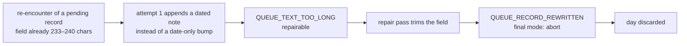

# 2026-11-05: queue grow-only/length-cap deadlock, fourth recurrence

Scheduled run 42029203188 (`radar-daily`, 2026-11-05, base `1d9d25f`). It failed at **"Enforce run outcome (fail on incomplete)"** with `ABORT RUN_INCOMPLETE - outcome validation`. That step only reports the outcome; the run failed earlier, at revalidation after the repair pass. Status: **cause established from the run log and diagnostics artifact; no fix applied; no recovery run.** The same investigation found a defect in the U12 coverage sensor (below).

## What happened

| Step | Result | Evidence |
|---|---|---|
| Radar run (attempt 1) | success: 112 turns, 852 s, $2.90, model `claude-sonnet-5` | log, result block |
| Validate (attempt 1) | `verdict=repairable`, **23** violations | log; `violations-1.txt` |
| Repair pass (one allowed) | success: 75 turns, 478 s, $1.77; `Edit` ×19, no web fetches | log; `model-run-facts.json` |
| Revalidate (final) | `verdict=abort`, `failure_class=validation`, **2** violations, both new | log; `violations-1b.txt` |
| Deliver | skipped, so no commit and no report for 2026-11-05 | job summary: `commit \| none` |

Attempt 1's 23 violations fall into three groups:

| Rule | Count | What it means |
|---|---|---|
| `FIELD_MISSING` (`verification`) | 15 | Every new entry of the day lacked the required `verification` frontmatter field |
| `REPORT_ITEM_NOT_ELIGIBLE` | 6 | Follows from the above: report items must be `verified` (3 per domain) |
| `QUEUE_TEXT_TOO_LONG` (`action_needed`) | 2 | `ai_engineering.md:143` and `social_science.md:266` |

After the repair, these two remained:

```
REPAIRABLE QUEUE_RECORD_REWRITTEN reviews/deferred_candidates/ai_engineering.md:143 - justification text must grow, never be rephrased (action_needed)
REPAIRABLE QUEUE_RECORD_REWRITTEN reviews/deferred_candidates/social_science.md:266 - justification text must grow, never be rephrased (action_needed)
```

## Root cause

**The grow-only/length-cap deadlock (baseline playbook P9) recurred.** Both records already existed and were pending at the base, and their `action_needed` fields were already at or near the 240-character cap:

| Record | `action_needed` length at base `1d9d25f` |
|---|---|
| `ai_engineering.md:143`, `anthropic.com/engineering/how-we-contain-claude` | 233 |
| `social_science.md:266`, `gsmaintelligence.com/research` | 240 (at the cap) |

Attempt 1 re-encountered both and appended a dated note, which pushed them past 240 characters. The engine's rule for this case is to record only the `last_encountered` bump ("the bound always outranks the append", `engine/ENGINE.md`, Deferral procedure), and the model did not follow it. The repair pass then trimmed both fields below 240 characters, as its final message says ("trimmed both over-length `action_needed` fields below the 240-character bound while preserving their meaning"). Trimming is the edit that *looks* like the fix, but it rewrites grow-only text, so the violation became a final-mode abort.



This is the fourth occurrence after 2026-08-05, 2026-08-07 and 2026-09-27 (`docs/ops/2026-08-12-validation-abort-review.md`; HDAI-AIRADAR-001 P9). The 08-12 fix was prose only: the "bump the date only" instruction. The structural fix recorded as open in HDAI-AIRADAR-001 §12 was never built: the validator should accept a date-only bump at the cap, and the repair prompt should forbid shortening.

**The exposure is growing.** At `main` @ `08076e3`, 9 pending `action_needed` fields are within 15 characters of the cap (225–240): 8 in `social_science.md`, 1 in `ai_engineering.md`. Each of them will trigger the deadlock the next time a run appends to it.

**Contributing: 15 entries without `verification`.** Attempt 1 omitted the field from every new entry. No commit between `9fe3e09` and `1d9d25f` touched `engine/schema.md` or `engine/templates/`, so the cause is not a specification change. It is a model-adherence miss. Whether it recurred in later runs that needed a repair (11-06) is unknown: diagnostics are uploaded only for incomplete runs. The repair pass fixed it by writing `verification: partial` into all 15 entries and moving the six report items to "Also archived today". **The repair made a verification judgment without fetching anything** (`web_fetches: 0`), reasoning from each entry's own notes. That is outside a repair's remit: verification status is evidence-bearing. Delivery was aborted anyway, so nothing reached `main`.

## Second finding: the coverage sensor reads the wrong log on repaired runs

The U12 coverage rows for this run read `0 of 19 attempted` (social science) and `0 of 17 attempted` (AI engineering). The same summary reports 17 and 9 scan fetches from the evidence file. The rows are wrong.

- **Mechanism [measured]:** the action writes every invocation's transcript to one fixed path, `/home/runner/work/_temp/claude-execution-output.json` (log lines "Log saved to …" after attempt 1 *and* after the repair pass). The workflow correctly passes `steps.model1.outputs.execution_file` to the coverage sensor (`.github/workflows/radar-daily.yml`, `summarize` step), but by then the repair pass has overwritten that file. The sensor is therefore measuring the repair transcript, which has no fetches.
- **Scope [measured]:** all 6 scheduled runs since U12 landed that had a repair pass report 0/19 and 0/17 (10-29, 10-30, 11-02, 11-04, 11-05, 11-06). All 7 without one report 16–17/19 and 7–17/17 (`gh run view <id> --log`, `curated coverage` rows).
- **Consequence:** the U12 floors cannot be enforced as built. Once they are on, every repaired run would fail for low coverage, whatever its real coverage.
- **Fix (proposed):** in the workflow, copy attempt 1's execution file to `$RADAR_DIR` immediately after the model step, and point both `summarize_execution_log.py` (for attempt-1 facts) and the coverage sensor at the copy. Add a structure test asserting that the coverage input is never the shared path after a repair step has run.

## Impact

- No 2026-11-05 report in either domain. Attempt 1's 15 accepted entries were discarded. A keyword check of the library on 2026-11-09 found at least 6 of the 15 topics later archived by other runs, two under the identical slug in `08076e3` [interpretation: titles were matched by keyword, not item by item].
- $4.67 of model spend produced no delivery.

## Proposed fixes (not applied; protected paths need the user's approval)

1. **Structural P9 fix.** The date-only bump is already valid: `last_encountered` is the only field in `MUTABLE_UNATTENDED` (`scripts/validators/lib_queues.py`). What is missing is a safe repair for an over-cap append to an existing record. Options: (a) when the base field exists, `QUEUE_TEXT_TOO_LONG` names the fix ("restore the base text; bump `last_encountered` only") so the repair is never a trim; or (b) the better fix, move re-encounter notes out of the capped fields into a separate dated list that has no per-field cap (as P9 recommends).
2. **Repair prompt:** state that shortening or rephrasing an existing queue field is never a fix, and that the repair for `QUEUE_TEXT_TOO_LONG` on an existing record is to restore the base text exactly.
3. **Repair scope:** forbid the repair pass from setting `verification`. A missing `verification` should become `provisional` status (not report-eligible) or abort; the repair should not judge it.
4. **Coverage sensor:** preserve attempt 1's transcript before any repair (above).

## Lessons

- An instruction-only fix for a structural deadlock fails at the model's adherence rate. Four recurrences in three months, with a growing set of fields at the cap, are the measured cost (P9, *revalidated*).
- Test what a sensor actually reads, not the name of its input. U12's structure test asserts that the workflow never passes the repair step's output to the coverage sensor (`tests/validators/test_workflow_structure.py`), but both steps' outputs are the same file, so the test passes while the sensor reads the repair transcript.
