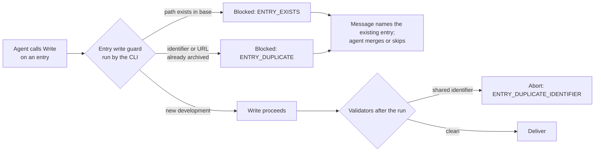

# 2026-11-10: the scan missed dedup and wrote over two existing entries

Scheduled run 42819765946 (`radar-daily`, 2026-11-10, started 12:54 UTC, base `3295b13`). It failed at **"Enforce run outcome (fail on incomplete)"** with `ABORT RUN_INCOMPLETE - outcome validation`. The run failed earlier, at the first validation. Status: **cause established from the run log and diagnostics artifact; fix applied the same day (plan 2026-11-09-001 U7b); no recovery run.**

## What happened

| Step | Result | Evidence |
|---|---|---|
| Radar run (attempt 1) | success: 147 turns, 1,419 s, $6.09, model `claude-sonnet-5` | log, result block |
| Validate (attempt 1) | `verdict=abort`, `failure_class=validation`, 7 violations | log; `violations-1.txt` |
| Repair pass | not run: abort-class findings are never repaired | job steps |
| Deliver | skipped, so no commit and no report for 2026-11-10 | job summary: `commit \| none` |

The violations (from the diagnostics artifact):

```
ABORT ENTRY_FRONTMATTER_FIELD_CHANGED library/entries/2026-donno-agent2agent-authorization-propagation.md - entry frontmatter field publisher_or_author may not change in automation
ABORT ENTRY_FRONTMATTER_FIELD_CHANGED library/entries/2026-donno-agent2agent-authorization-propagation.md - entry frontmatter field rationale may not change in automation
ABORT ENTRY_BODY_REWRITTEN library/entries/2026-donno-agent2agent-authorization-propagation.md - entry body text before or within existing content was altered
ABORT ENTRY_FRONTMATTER_FIELD_CHANGED library/entries/2026-saxena-decision-models-economic-surrogates.md - entry frontmatter field publisher_or_author may not change in automation
ABORT ENTRY_FRONTMATTER_FIELD_CHANGED library/entries/2026-saxena-decision-models-economic-surrogates.md - entry frontmatter field rationale may not change in automation
ABORT ENTRY_BODY_REWRITTEN library/entries/2026-saxena-decision-models-economic-surrogates.md - entry body text before or within existing content was altered
REPAIRABLE REPORT_QUIET_DAY_STATEMENT_MISSING reports/social_science/daily/2026-11-10.md - zero-item report lacks the quiet-day statement
```

## Root cause

**The scan did not dedup five arXiv candidates that were already in the library** (engine P2 step 4; `engine/schema.md`, Dedup matching, rule 1). The agent's final message (`model-run-facts.json`) says so:

> I failed to dedup five arXiv candidates (already archived by an earlier run) before writing — this created three orphan duplicate entries (flagged for deletion in their own files) and overwrote two existing entries' body text with freshly-regenerated content

- **Two overwrites.** The agent wrote a regenerated entry to the path of an existing one. `check_changed_paths.py` caught both (entry bodies and most frontmatter fields are immutable in automation) and the run stopped. This is the sensor working as designed.
- **Three duplicates under new slugs.** No validator flagged them. Had they been the only defect, the run would have delivered three duplicate entries. This was a gap.

Why the agent skipped the dedup step is **not established**: the transcript is not retained (R43). The run made 12 `Grep` calls and 14 `Write` calls.

**Why the system allowed it:** dedup was an instruction only. The rule's mechanical part (a shared identifier or URL means the same development) had no check at the moment of writing, and the model has no shell, so it could not run one itself.

## Impact

- One scan day lost: no entries and no reports for 2026-11-10. `main` is unchanged; no entry was damaged.
- Recovery is not needed: the search reaches back 7 days (P6.1), so the next run sees most of the same candidates.
- Cost: $6.09, the highest single run so far (mean since 10-17: $3.91).

## What the 2026-11-09 changes showed on their first real run

| Change (plan 2026-11-09-001) | Result |
|---|---|
| U1 deferral tools denied | settings accepted; no deferral tool in `model-run-facts.json` |
| U2 scan-transcript snapshot | worked: coverage read from the scan's own transcript |
| U7 coverage floors | passed: social science 16 of 19, AI engineering 16 of 17 |
| U3 queue normaliser | ran; 0 fields restored |
| U5 repair scope, U6 repair outcome | not exercised (no repair pass) |

## Fix (plan 2026-11-09-001 U7b, applied 2026-11-10)



1. **Entry write guard** (`scripts/entry_write_guard.py`): a PreToolUse hook on `Write`, registered in the model's settings and run by the CLI from the pristine base. It blocks a Write over an entry that exists in the base commit, and a new entry whose `canonical_ids` or source URL already belong to another entry (in the base, or written earlier in the run). The block message names the existing entry and the rule, so the agent corrects itself in the same run. The guard fails open; the validators remain the gate.
2. **Validator backstop**: `ENTRY_DUPLICATE_IDENTIFIER` (abort) in `check_library_consistency.py`, for two entries sharing a canonical identifier. It closes the gap that let the three duplicates pass.
3. **Measurement**: the run summary gains `duplicate entry writes blocked by harness`, and `entry guard errors` when the guard itself faulted.
4. **Prompt**: the run prompt tells the agent to search the index before each entry and how to act on a block.

Checks: 20 new tests, including the two failure shapes of this run. The current library (465 entries) has no shared canonical identifier. Two pairs of older entries share a source URL (`2026-althoff-…` / `2026-anthropic-hermle-…`, and two `2026-botvinick-…` entries); they are left for the user's triage.

**Not yet verified in production:** that the pinned action runs hooks from the settings file. Because the guard fails open, a hook that does not run leaves the system as it was on 2026-11-10, plus the new validator rule. The first model run shows it: the summary row is present either way, so the evidence is a non-zero count on a day with re-encounters.

## Lessons

- A rule the agent must remember is a feedforward guide, not a control. Dedup now has a sensor at the point of action.
- A hook is the way to give a shell-less agent a fast deterministic check: the harness runs it, the agent only reads the result.
- A validator that catches one shape of a failure (overwrite) can hide that a sibling shape (duplicate under a new name) is unchecked. Enumerate the shapes.
