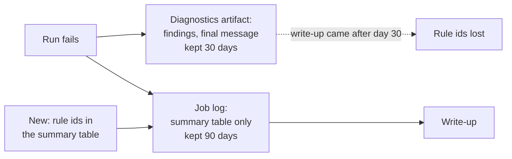

# Review of the four red runs of September 2026 (09-10, 09-11, 09-12, 09-27)

Written 2026-11-10 (plan 2026-11-09-001 U9), from the run logs, which GitHub keeps for 90 days. The diagnostics artifacts of all four runs had expired (30-day retention), so the findings files are gone. Status: **09-27 cause established; 09-10, 09-11 and 09-12 cause not recoverable, bounded only; no recovery runs.**

## What the logs show

All four ran `claude-sonnet-5`, failed at "Enforce run outcome" with `outcome validation`, and delivered nothing.

| Run date | Run | Scan | Validation | Repair | Work discarded |
|---|---|---|---|---|---|
| 09-10 | 34458759391 | 102 turns, 800 s, $3.13 | `abort`, 1 finding | not run | 4 new entries; 3 AI-engineering report items |
| 09-11 | 34582325808 | 119 turns, 964 s, $3.86 | `abort`, 1 finding | not run | 10 new entries; 2 + 3 report items |
| 09-12 | 34684152469 | 97 turns, 837 s, $3.37 | `abort`, 4 findings | not run | 8 new entries; 1 + 3 report items |
| 09-27 | 36311658264 | 73 turns, 731 s, $1.91 | `repairable`, 1 finding | 10 turns, 29 s, $0.14; then `abort`, 1 finding | 1 rejection line; both reports quiet |

Source: each run's result block, validate output and job summary in the log.

## 09-27: the queue deadlock, third occurrence (established)

The findings were `QUEUE_TEXT_TOO_LONG` before the repair and `QUEUE_RECORD_REWRITTEN` after it. They were read from the diagnostics artifact while it still existed (HDAI-AIRADAR-001, verification note 11; reconfirmed in HDAI-AIRADAR-002). A re-encounter append pushed a grow-only queue field past 240 characters; the repair pass shortened it; shortening is a rewrite, which aborts. One finding in, one different finding out: in today's terms, repair outcome `regressed`.

This is the same mechanism as 08-05, 08-07 and 11-05 (`docs/ops/2026-11-05-queue-deadlock-recurrence-incident.md`). The harness-side fix landed on 2026-11-09 (plan 2026-11-09-001 U3: the normaliser restores the base text before validation).

## 09-10, 09-11, 09-12: three abort days in a row (not recoverable)

What is established:

- Validation aborted at the first pass on each day, with 1, 1 and 4 findings. `failure_class=validation` and `degenerate=false`.
- No repair pass ran, so at least one finding each day was **abort-class**. With one finding on 09-10 and on 09-11, that finding was abort-class.
- Scan-evidence faults are excluded: they give the outcome `tooling`, not `validation`.
- That leaves the abort rules of `check_changed_paths.py` (allowlist, history, queue lifecycle, report date, rejection log, entry preservation) and of `check_report_integrity.py` (a report item without its entry).
- The scans themselves were normal: 97 to 119 turns, 22 to 27 fetches, 22 new entries across the three days.
- The streak ended without a change: no commit touched the harness, engine or prompt between the 09-09 and 09-13 runs (the only commits were two presentation documents on 09-11). The 09-13 run delivered from the same base as the three failures plus those two documents.

What is not established: which rule fired, on which file, and why three days in a row. The agent's final messages were in the expired artifacts too.

**Recovery.** None was run. The 09-13 and 09-14 runs delivered 8 and 1 new entries. Whether they covered the 22 discarded entries cannot be checked: the discarded entries are not recorded anywhere.

## Why the evidence was lost, and the fix

The findings file was only in the artifact, and the first write-up attempt came 34 days after 09-10 (HDAI-AIRADAR-001, 2026-10-14). The job summary carried counts but no rule ids.

Fix (2026-11-10, with this review): the run summary now has a row per validation stage, `validation findings (attempt 1 | after repair | attempt 2)`, listing rule ids and counts, for example `ENTRY_BODY_REWRITTEN x2`. Rule ids are registered constants, so the row is safe for the public log (R47). The summary is printed to the job log, so the rule ids now last 90 days, and a write-up needs no artifact for the first question: what failed.

## Lessons

- An evidence store shorter-lived than the review cycle loses the evidence. Either review inside the window or put the facts in the longer-lived store. We did the second.
- A failure that repeats on consecutive days and then stops on its own still needs its cause. Three days and 22 entries were lost here, with no way now to learn why.
- Every red run gets a write-up within the week, at the latest in the weekly handover (plan 2026-11-09-001 U11 adds the reminder).
