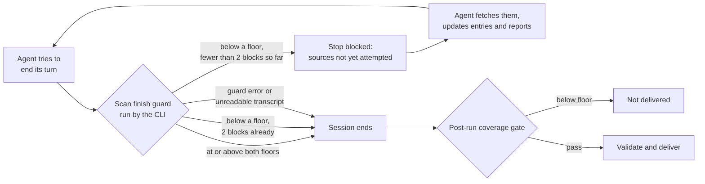

# 2026-11-11: a shallow scan stopped by the coverage floor

Scheduled run 43017169301 (`radar-daily`, 2026-11-11, started 12:04 UTC, base `3f9647f`). It failed at **"Enforce run outcome (fail on incomplete)"** with outcome `coverage`. Status: **the gate worked as decided on 2026-11-09 (below the floor, do not deliver); why the scan was shallow is not established; in-run coverage check applied the same day (plan 2026-11-09-001 U7c).**

## What happened

| Step | Result | Evidence |
|---|---|---|
| Radar run (attempt 1) | success: 94 turns, 859 s, $3.35, model `claude-sonnet-5` | log, result block |
| Validate (attempt 1) | `verdict=abort`, `failure_class=coverage`, 1 finding | run summary: `validation findings (attempt 1) \| COVERAGE_BELOW_FLOOR x1` |
| Repair, attempt 2 | not run: a repair cannot add fetches | job steps |
| Deliver | skipped: no commit, no reports for 2026-11-11 | job summary |

```
ABORT COVERAGE_BELOW_FLOOR scan-coverage - curated-source coverage for social_science is 9 of 19, below the floor 12
```

- Social science: 9 of 19 watchlist sources attempted (floor 12). Not attempted: Daron Acemoglu, OECD, VoxDev, J-PAL, GSMA Intelligence, ITU, Cosmos Institute, Google / Google DeepMind economics research, Telecommunications Policy, Political Analysis.
- AI engineering: 6 of 17 attempted, exactly at the floor of 6. Eleven sources were not attempted.
- The reading is real, not a sensor fault: the agent's own evidence file reports 7 and 6 curated sources fetched, and the transcript holds 31 fetches against 56 the day before.

## Cause

**Not established.** The transcript is not retained (R43). The agent's final message reports all success conditions met and does not mention the skipped sources. It wrote 11 entries and two reports from what it did fetch, mostly arXiv and NBER.

What the history shows: shallow days are a recurring behaviour of this agent, not a new one.

| Period (model `claude-sonnet-5`) | Runs | Days with fewer than 12 social-science sources fetched (self-reported) |
|---|---|---|
| 09-02 → 10-26 | 37 | 12 |
| 10-27 → 11-10 | 15 | 1 (10-30: 11) |
| 11-11 | 1 | 1 (7) |

From 10-27 the sensor readings that are valid were 16 or 17 of 19 every day until this run. Nothing in the 2026-11-10 changes tells the agent to fetch less; with one day of data, a link to them can be neither shown nor ruled out.

## Impact

- One scan day lost: 11 new entries and 4 report items discarded, $3.35 spent. `main` is unchanged.
- Recovery is not needed: the search reaches back 7 days (P6.1).
- Second lost day in a row (11-10: dedup miss). Different causes.

## What the 2026-11-10 changes showed

| Change | Result |
|---|---|
| Rule ids in the run summary (U9) | worked: the cause class was readable from the job log alone |
| Effort rows (U8) | worked: 94 turns against a reference of 127; no alarm (the threshold is 50%) |
| Entry write guard (U7b) | **inconclusive**: 0 writes blocked, and the log could not show whether the hook ran at all |
| Commit trailers (U8) | not exercised: nothing was delivered |

Fixed with this record: the guard now logs every entry Write it lets through, and the run summary has the row `entry writes checked by harness guard`. A zero there on a day with new entries means the hook is not running.

## Fix (plan 2026-11-09-001 U7c, approved and applied 2026-11-11)

The floor is a post-run gate: it can only reject the day. The agent never learns during the run that it is below the floor. The same pattern as the entry write guard would fix that: a hook at the moment the agent tries to finish, which measures coverage from the session so far and, below the floor, sends the agent back with the list of sources not yet attempted. A shallow day would then become a completed scan instead of a lost one. The post-run gate stays as the backstop.



Built as `scripts/scan_finish_guard.py`: it uses the post-run gate's own measuring code and floors, so the two cannot disagree. The run prompt now also states the minimum, which the agent had never been told. The repair pass has its own settings without this hook, because a repair fetches nothing by design.

It was wired in before hooks were proven on the pinned action. That is safe because the guard fails open and can block at most twice; if hooks do not run, the system behaves as it did on 11-11. The summary row `finish checks run by harness guard` shows on the next model run whether it ran.

## Lessons

- A gate without in-run feedback converts a quality problem into an availability problem. It is the right backstop and the wrong first line.
- "0 events" from a sensor is evidence only if the sensor also proves it was running.
