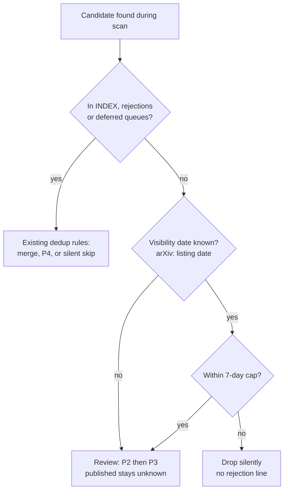
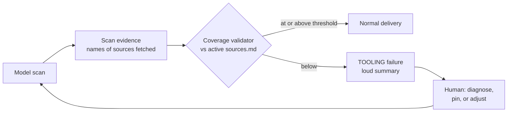

# fix: Discovery coverage — scan-depth collapse and the window boundary

## Summary

Two defects make the radar miss material it should catch, and the harness reports both as success. **(A) Scan-depth collapse:** since the 2026-09-29 run, the unattended scan has fetched 1–4 curated sources per domain (against 9–17 before) and finished in 1–2 minutes (against 8–19), with no change to the repository. **(B) The window boundary:** P6.1 bounds discovery by the date of the last report but never says *which* date of a candidate counts. The runs have used the submission date, which rejected 243 candidates as "not new", 157 of them self-scored as otherwise high. This plan diagnoses and fixes (A) first, because no window fix can be judged on a scan that barely runs. It then adds the missing sensor (scan coverage), separates the search window from eligibility, and re-reviews what was lost. Six units, each ending at a user checkpoint.

---

## Problem Frame

The defects surfaced together. The user found a high-relevance working paper the radar had never seen (The Anthropic Institute WP 2026-02, published September 2026). Tracing why exposed three causes. Two were resolved the same day: the source was missing from the watchlist, and its hosts were missing from the egress allowlist (commit `b31ad25`). The third, the window rule, prompted a look at the rejection log, and that look exposed the collapse.

### Evidence (measured 2026-10-16)

**Scan depth.** `curated sources fetched` from the reports' scan-evidence blocks (social science / AI engineering), and run duration from `gh run list`:

| Run dates | Social science | AI engineering | Duration | Outcome |
|---|---|---|---|---|
| 2026-09-17 to 09-26 | 9–17 | 12–15 | 8–19 min | success (09-27: failure, 13 min) |
| 2026-09-28 | 9 | 13 | 9 min | success |
| **2026-09-29 to 10-16** | **1–4** | **1–3** | **1–2 min** | **success, every day** |

The active watchlists have 25 (social science) and 17 (AI engineering) sources. After 2026-09-28 the runs stopped writing to `library/rejections.md` entirely (133 lines in the 18 days before, 0 in the 18 days after) and touched the deferred queues in only 2 of 17 run commits (10 of 15 before). Nothing under `.github/`, `engine/`, `scripts/` or `profiles/` changed between the 09-28 and 09-29 runs. The workflow pins `anthropics/claude-code-action@v1` (a floating major tag) and sets no model, so the action, the CLI or the default model can change without a commit. That is the leading hypothesis, and it is unconfirmed.

**Window rejections.** From `library/rejections.md`:

| | Count |
|---|---|
| Rejections citing the window ("window boundary", "not new within", "already covered by", "outside this run's") | 243 (Jul 2, Aug 38, Sep 203) |
| …that record what the candidate would otherwise have scored | 197 |
| …that say "would otherwise have scored high" | 157 |

The typical case is arXiv, where submission and visibility differ. "The Economics of Recursive Self-Improvement" (arXiv:2609.15802) was submitted on Mon 14 Sep 16:12 UTC and first listed on 15 Sep. The 14 Sep run could not see it; the 15 Sep run saw it, dated it 14 Sep ("already covered"), and rejected it. Neither run could ever have accepted it.

### Why the harness said "success"

The scan-evidence check (R39) proves that the evidence artifact *exists and is well formed*. It does not check that the activity is *adequate*: "curated sources fetched: 1" passes. Truthfulness and depth of model-attested activity were recorded as an accepted model-judgment risk in the v2 plan. Defect (A) is that risk materialising, and nothing was measuring it.

---

## Requirements

Numbering continues from the v2 plan (R1–R50).

- R51. The cause of the 2026-09-29 collapse is established from evidence (run logs and diagnostics artifacts: action and CLI version, model, turn count, stop reason, cost), not inferred, and recorded in `docs/ops/`.
- R52. The unattended run pins what can change silently: the action by commit SHA and the model by explicit ID. Upgrades become deliberate commits.
- R53. **Coverage sensor:** the scan-evidence artifact lists the curated sources fetched by name, per domain. A validator compares them against the active rows of `profiles/<domain>/sources.md`. Coverage below a threshold is a TOOLING failure (loud), never a quiet-day success.
- R54. **Search window ≠ eligibility.** P6.1's window bounds where a run *looks* (since the last report). It no longer decides whether a found candidate is *new*. "New" means not already in `INDEX.md`, `rejections.md` or the deferred queues, and first visible no more than 7 days before today (the existing cap).
- R55. **Visibility date:** when a source distinguishes them, the date that counts is the date the item became publicly visible (arXiv: first listing/announcement date), never the submission date. When only one date is known, use it. When none is known, the candidate is eligible, and the entry's `published` stays `unknown` (never inferred).
- R56. A candidate is never rejected *solely* because of its date while it is within the 7-day cap. Older-than-cap candidates are dropped silently as before (no rejection line), so the log stops filling with date-only rejections.
- R57. The window-rejected candidates are re-reviewed once, interactively, as an approved batch. The rejection log stays append-only: original lines are never edited, and outcomes are recorded as new entries or as dated re-review lines.
- R58. The gap (2026-09-29 to the fix date) gets a one-off catch-up scan of the curated sources, run interactively.
- R59. The loop is measured: per-run coverage ratio, date-only rejections (target 0) and catch-up yield, reported at close and in the HDAI handover.

---

## Key Technical Decisions

- **Diagnose before fixing.** U11 comes first, and U13–U16 are blocked on it. A window fix tested on a 1-minute scan proves nothing.
- **Sensor, not instruction.** Asking the model to "scan all sources" already exists in P6.2 and was not followed. Per the project's feedback-loop rule, the guarantee comes from a deterministic check against real evidence (R53), not from more prompt text.
- **Coverage threshold: recommend starting at the lowest healthy pre-collapse value per domain**: 9 of 25 (36%) for social science and 12 of 17 (71%) for AI engineering. Healthy runs ranged 36–68% and 71–88% respectively, so a single 60% bar would fail healthy social-science days, while these per-domain floors still catch every collapsed run (1–4 sources). U12 calibrates against all pre-collapse evidence before enforcing it. Per-domain and fail-loud. Open question: whether a run below the threshold triggers the statically unrolled attempt 2 or fails immediately.
- **Eligibility by dedup, not by date (R54).** The library already has an exact mechanism for "seen before": `INDEX.md`, `rejections.md` and the queues. The date comparison was a lossy proxy for it, and it fails exactly where submission and visibility differ. Keeping the 7-day cap bounds the review load.
- **No schema change.** `engine/schema.md` stays frozen. Changes land in `engine/ENGINE.md` P6.1 (manual and unattended), the run prompt, and the validators.
- **Protected paths.** `.github/` (U11 pinning, U14 prompt) is protected and changes only with explicit per-unit approval, as in v2.

---

## High-Level Technical Design

### Candidate eligibility (after the fix)

The search window (since the last report) decides only where the run looks. It does not appear in this decision.

### The missing loop

---

## Implementation Units

### Phase A — Restore the scan

### U11. Diagnose the 2026-09-29 collapse and pin what drifts

- **Concept:** a regression with no commit — dependencies that float (action tag, default model) are inputs to the system too.
- **Requirements:** R51, R52.
- **Dependencies:** none. **Blocks:** U13–U16.
- **Files:** `docs/ops/2026-10-xx-scan-depth-collapse-incident.md` (new); `.github/workflows/radar-daily.yml` (protected: SHA pin + explicit model, only after approval).
- **Approach:** pull the logs and diagnostics artifacts of runs 36414063914 (09-28, healthy) and 36558180331 (09-29, first collapsed), plus one recent run. Compare action and CLI versions, model ID, turn count, stop reason, cost and the model-run-facts JSON. Confirm or reject the floating-tag hypothesis. Other candidates: usage or rate limits, a changed default effort or turn budget, prompt-cache behaviour. Fix the cause, then pin. Running `gh` against the logs from a local session needs the user's permission (in this session it was blocked by the sandbox and the auto-mode check), so the user either runs those commands or grants a permission rule.
- **Test scenarios:** one `workflow_dispatch` no-push run after the fix shows pre-collapse-level coverage and duration.
- **Checkpoint:** user approves the incident write-up and the pinning diff.

### U12. Coverage sensor in the scan-evidence validator

- **Concept:** turning an accepted risk into a measured one — a deterministic check that the work was actually done, not just that the receipt exists.
- **Requirements:** R53, R59.
- **Dependencies:** U11 (its findings set the threshold calibration).
- **Files:** `scripts/validators/check_scan_evidence.py`, `scripts/validators/README.md` (contract), `tests/validators/test_check_scan_evidence.py`, `engine/ENGINE.md` (scan-evidence schema gains a `curated_sources` name list), `.github/prompts/daily-radar.md` (protected).
- **Approach:** extend the evidence JSON with per-domain `curated_sources: [names]` (the count is kept for compatibility). The validator parses the active rows of each `sources.md`, matches names, computes the ratio, and fails with a no-echo message (R47 style) below the threshold. Calibrate the threshold on the pre-collapse run evidence before enforcing it.
- **Test scenarios:** full coverage → pass; 1 of 25 → TOOLING failure; a name not on the watchlist does not count; a missing list → failure; a renamed source row → covered by a documented matching rule.
- **Checkpoint:** user approves the threshold and the failure behaviour (fail immediately vs. attempt 2).
- **Revision (2026-10-26, implementation; approved by the user 2026-10-26: report-only first, the `fetch hosts` mapping including search-only researchers, the workflow change).** U11 showed the self-reported count cannot separate a healthy run from a collapsed one, so the sensor is harness-side and the evidence JSON, `ENGINE.md` and the run prompt are unchanged. `scripts/validators/check_scan_coverage.py` reads the WebFetch calls from the scan attempt's execution log and matches them against a new `fetch hosts` column in `profiles/<domain>/sources.md` (exact host, optional path prefix; every host must be on the egress allowlist, which a test checks). Sources without a fetchable host (6 social-science researchers) are reported as search-only and left out of the ratio. Raw execution logs were never retained, so no pre-collapse fetch data exists to calibrate on. The sensor therefore ships **report-only**: coverage rows in the run summary, the record in `diagnostics/coverage.json`. After about seven scheduled runs, the user sets per-domain floors and the failure behaviour, and a follow-up change wires `--min-ratio` into `run_delivery.py validate`. Open question 2 is resolved: the sensor uses the fetch tool calls, not the self-report.

### Phase B — Fix the window

### U13. Engine: separate the search window from eligibility

- **Concept:** a proxy that drifted from its purpose — the date check stood in for "seen before", which dedup already answers exactly.
- **Requirements:** R54, R55, R56.
- **Dependencies:** U11.
- **Files:** `engine/ENGINE.md` (P6.1, P6.4, plus the matching line in Unattended mode); `engine/schema.md` (expected: no change, stop and ask if one appears necessary).
- **Approach:** rewrite P6.1 into two sentences: the search window (unchanged), and eligibility per R54/R55/R56. Add the visibility-date rule with the arXiv case named. State that date-only rejections no longer exist.
- **Test scenarios (desk-walks):** the RSI paper replayed (submitted on the boundary day, listed the next) → reviewed; a 3-day-late cross-post → reviewed; a 9-day-old item → silent drop; an item already in INDEX → merge path; an undated item → reviewed, `published: unknown`.
- **Checkpoint:** user approves the P6 diff; the manual path must read unchanged except for P6.1.

### U14. Run prompt and validator alignment

- **Requirements:** R54–R56.
- **Dependencies:** U13.
- **Files:** `.github/prompts/daily-radar.md` (protected; the "Lookback per P6.1" line), `scripts/validators/check_report_integrity.py` only if the report's "Window searched" line changes meaning, tests.
- **Approach:** minimum diff, pointing at the new P6.1 rather than restating it.
- **Implemented 2026-10-26 with U13.** P6.1 also exempts date-only rejection-log lines from discovery dedup, so candidates rejected for their date within the last 7 days are reviewed again automatically; older ones remain U15's batch. The prompt keeps one sentence beyond the pointer (the ban on date rejections and the arXiv listing-date rule), because the runs had applied the date logic consistently. No validator change: the report's "Window searched" line keeps its meaning. `engine/schema.md` is unchanged.
- **Checkpoint:** user approves; one supervised `workflow_dispatch` no-push run shows zero date-only rejections and normal coverage.

### Phase C — Recover what was lost, and measure

### U15. Re-review the window rejections and catch up on the gap

- **Concept:** closing an outer loop — the lost candidates become a to-do list for the agent, and humans resolve only what remains.
- **Requirements:** R57, R58.
- **Dependencies:** U13 (re-review uses the new rule).
- **Files:** `inbox/2026-10-xx-window-rereview.md` (generated); entries and INDEX rows as dispositions dictate; `library/rejections.md` (dated re-review lines only).
- **Approach:** a script (mechanical step) extracts the 243 window-rejected lines into an inbox list, ordered "would otherwise have scored high" first, with identifiers preserved. The user approves the list, and it is processed with P5 interactively, resumable, with every disposition per P3. Then a one-off catch-up scan of the curated sources for 2026-09-29 to the fix date, per domain, written as an ops note, not as backdated reports.
- **Test scenarios:** a re-reviewed item already ingested meanwhile → merge; a re-reviewed item now failing the library bar → dated re-review line, original line untouched.
- **Checkpoint:** user approves the generated list before processing, and again after the high-scored batch.

### U16. Measure and close

- **Requirements:** R59.
- **Dependencies:** U12, U14, U15.
- **Files:** `docs/ops/` close note; `docs/hdai/` delta handover (agentic-engineering lesson: silent degradation behind a success signal; sensors on adequacy, not just existence).
- **Approach:** report seven consecutive runs of coverage ratio and duration, date-only rejections (target 0), re-review yield (archived / merged / rejected out of 243) and catch-up yield.
- **Checkpoint:** user accepts the metrics and closes the plan.

---

## Risks and Mitigations

| Risk | Mitigation |
|---|---|
| The collapse cause is outside the repo (usage limits, provider-side change) and cannot be pinned away | U12's sensor makes any recurrence loud on day one; U11 records the cause and the residual risk |
| A coverage threshold the model can satisfy by listing sources it did not really fetch | Accepted model-judgment risk, now narrower: the harness can additionally cross-check names against fetch tool calls in the execution log (U12 open question) |
| Eligibility by dedup raises review load | Bounded by the 7-day cap and the curated-first order; measured in U16 |
| Re-review of 243 items is large | High-scored first; resumable P5; the user can stop after the first batch |
| Protected-path edits (`.github/`) | Per-unit explicit approval, as in v2; validators run from the pristine base unchanged |

## Scope Boundaries

- No schema change; no new entry statuses.
- No change to the report bar or to scoring.
- Backdated daily reports for the gap are out of scope: reports are never written for past dates. The catch-up yield lives in the library and in an ops note.

## Open Questions

1. Coverage threshold value and the below-threshold behaviour (U12).
2. Whether to cross-check evidence source names against actual fetch tool calls in the execution log (U12).
3. Visibility-date rules for sources other than arXiv (SSRN, NBER, journal "online first"); default to the earliest public date shown (U13).

## Definition of Done

- The collapse cause is recorded with evidence; action and model pinned (U11).
- Seven consecutive unattended runs at or above the coverage threshold, with the validator enforcing it (U12).
- Zero date-only rejections over those runs (U13–U14).
- 243 window rejections re-reviewed with outcomes recorded; the gap catch-up scan done (U15).
- Metrics reported and HDAI handover written (U16).
