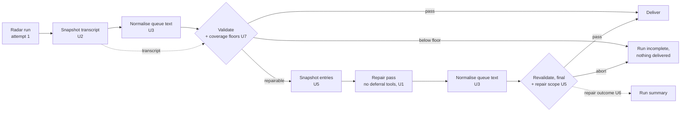

# fix: Harden the repair loop and the coverage sensor

## Summary

Two scheduled runs (10-30, 11-05) were lost at revalidation after the single repair pass. The causes were a repair that delegated its work and ended without an edit, and the fourth recurrence of the queue grow-only/length-cap deadlock (P9). The same investigation found that the U12 coverage sensor reads the repair transcript on every repaired run. This plan fixes all three with mechanism rather than instructions, then makes the repair loop measurable and closes the outer loop. Each phase ends at a user checkpoint.

## Phase 1: stop losing days (approved and done 2026-11-09)

| Unit | Change | Check |
|---|---|---|
| **U1** Deny deferral tools | `DEFERRAL_TOOLS` (`Agent`, `Task`, `ScheduleWakeup`, `ListAgents`, `SendMessage`, `Monitor`, `CronCreate`, `RemoteTrigger`) denied by bare name in `scripts/build_claude_settings.py`. The repair prompt now says the session ends when the agent stops, forbids handing work off, and forbids shortening existing queue text | `TestSettingsBuilder.test_deferral_tools_denied`; `test_repair_prompt_forbids_delegation_and_shortening`. In production: no deferral tool in any run's `model-run-facts.json` |
| **U2** Snapshot the scan transcript | A step after attempt 1 copies its `execution_file` to `$RUNNER_TEMP/radar-private/` (denied to the model, never uploaded). Coverage, the attempt-1 facts and the attempt-2 reset read the snapshot | `test_coverage_measured_from_scan_attempt_report_only`; `test_model_run_facts_derived_never_raw_execution_log`. In production: a repaired run's coverage within the range of unrepaired runs (16–17/19, 7–17/17) |
| **U3** Restore grow-only queue text | `scripts/normalize_queue_appends.py` runs before all three validations. For existing records it restores a grow-only field's base text when it was rephrased or pushed over 240 characters, keeping the `last_encountered` bump. The run summary gains "queue fields restored by harness" | `tests/validators/test_normalize_queue_appends.py`: 10 fixtures, including the 11-05 cap cases, the 11-05 trimmed repair output and the 10-30 rephrase, each validated by the real validators. Replay over the 22 delivered daily-run commits 10-17 → 11-08: 0 restorations (no false positives) |
| **U4** Pin the runner image | `runs-on: ubuntu-26.04` | `test_runner_image_pinned` |

**Residual risk.** If the CLI rejected a deny rule naming a tool it does not know, the model step would fail loudly (`auth`-class outcome) rather than silently. The first run after merge confirms it.

## Phase 2: make the repair loop safe and visible (approved and done 2026-11-09)

User decisions, 2026-11-09: floors social science ≥ 12 of 19 and AI engineering ≥ 6 of 17 attempted; **below the floor the run is not delivered**.

| Unit | Change | Check |
|---|---|---|
| **U5** Repair scope | Before the repair, the harness snapshots `library/entries/` to `$RUNNER_TEMP/radar-private/`. On revalidation, `check_repair_scope.py` aborts if the repair raised `verification` or `status`; a field it adds must be `unverified` / `provisional` (the schema already requires all-unverified entries to be provisional). The repair prompt states the rule | `tests/validators/test_check_repair_scope.py` (the 11-05 case: adding `partial` aborts; adding `unverified` + `provisional` passes) |
| **U6** Repair outcome | The run summary gains `repair outcome`: `fixed`, `no_progress` (10-30), `partial` or `regressed` (08-07, 09-27, 11-05), comparing (class, rule, file) of the findings before and after. The "before" findings are copied to the harness-private dir, because the repair pass can edit `$RADAR_DIR` | `TestRepairOutcome` with the real 10-30 and 11-05 findings. The pass rate across runs is computed from the run summaries in handovers (no state file) |
| **U7** Coverage floors | `ATTEMPTED_FLOORS` in `check_scan_coverage.py`, enforced by `run_delivery.py validate --scan-transcript` on attempt 1 (from the U2 snapshot), on revalidation, and on attempt 2 (its own transcript). Below the floor, or no transcript: abort, outcome class `coverage`, never sent to repair (a repair cannot add fetches). Coverage lines do not cancel the degenerate-run retry. Dry runs skip the gate | `TestCoverageGate`, `TestAttemptedFloors`. Replay over the logs: every unrepaired run 10-26 → 11-09 clears the floors (lowest: AI engineering 7 of 17 on 11-03) |

**Residual risk.** The gate fails closed: if the transcript snapshot (U2) were broken in production, every run would stop with outcome `coverage` and deliver nothing until fixed. That is loud, not silent, and the library is untouched. A supervised no-push run before the next scheduled run removes the risk.

## Phase 3: close the outer loop (awaiting approval)

- **U8 Effort and cost alarm** (rest of plan 2026-10-16-001 U16): turns, cost and duration in the run summary; alarm on turns below 50% of the rolling 7-run median, and on cost above a ceiling.
- **U9 Write-ups for the 09-10, 09-11, 09-12 and 09-27 red runs** before their logs expire (90-day default).
- **U10 Queue triage sheet** for the user, ordered by closeness to the cap.
- **U11 Weekly handover reminder.**

## Out of scope

- U15 of plan 2026-10-16-001 (210-paper re-review): paused by the user.
- A catch-up scan for 10-30 and 11-05: not recommended. The 7-day cap let the next runs see most of the same window.
- Moving re-encounters to a separate dated list (P9's cleaner fix): held unless U3's restorations prove frequent.
