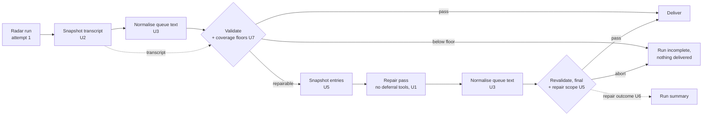

# fix: Harden the repair loop and the coverage sensor

## Summary

Two scheduled runs (10-30, 11-05) were lost at revalidation after the single repair pass. The causes were a repair that delegated its work and ended without an edit, and the fourth recurrence of the queue grow-only/length-cap deadlock (P9). The same investigation found that the U12 coverage sensor reads the repair transcript on every repaired run. This plan fixes all three with mechanism rather than instructions, then makes the repair loop measurable and closes the outer loop. Each phase ends at a user checkpoint.

## Phase 1: stop losing days (approved and done 2026-11-09)

| Unit | Change | Check |
|---|---|---|
| **U1** Deny deferral tools | `DEFERRAL_TOOLS` (`Agent`, `Task`, `ScheduleWakeup`, `ListAgents`, `SendMessage`, `Monitor`, `CronCreate`, `RemoteTrigger`) denied by bare name in `scripts/build_claude_settings.py`. The repair prompt now says the session ends when the agent stops, forbids handing work off, and forbids shortening existing queue text | `TestSettingsBuilder.test_deferral_tools_denied`; `test_repair_prompt_forbids_delegation_and_shortening`. In production: no deferral tool in any run's `model-run-facts.json` |
| **U2** Snapshot the scan transcript | A step after attempt 1 copies its `execution_file` to `$RUNNER_TEMP/radar-private/` (denied to the model, never uploaded). Coverage, the attempt-1 facts and the attempt-2 reset read the snapshot | `test_coverage_measured_from_scan_attempt_report_only`; `test_model_run_facts_derived_never_raw_execution_log`. In production: a repaired run's coverage within the range of unrepaired runs (16–17/19, 7–17/17) |
| **U3** Restore grow-only queue text | `scripts/normalize_queue_appends.py` runs before all three validations. For existing records it restores a grow-only field's base text when it was rephrased or pushed over 240 characters, keeping the `last_encountered` bump. The run summary gains "queue fields restored by harness" | `tests/validators/test_normalize_queue_appends.py`: 10 fixtures, including the 11-05 cap cases, the 11-05 trimmed repair output and the 10-30 rephrase, each validated by the real validators. Replay over the 22 delivered daily-run commits 10-17 → 11-08: 0 restorations (no false positives) |
| **U4** Pin the runner image | `runs-on: ubuntu-26.04` | `test_runner_image_pinned` |

**Residual risk.** If the CLI rejected a deny rule naming a tool it does not know, the model step would fail loudly (`auth`-class outcome) rather than silently. The first run after merge confirms it.

## Phase 2: make the repair loop safe and visible (approved and done 2026-11-09)

User decisions, 2026-11-09: floors social science ≥ 12 of 19 and AI engineering ≥ 6 of 17 attempted; **below the floor the run is not delivered**.

| Unit | Change | Check |
|---|---|---|
| **U5** Repair scope | Before the repair, the harness snapshots `library/entries/` to `$RUNNER_TEMP/radar-private/`. On revalidation, `check_repair_scope.py` aborts if the repair raised `verification` or `status`; a field it adds must be `unverified` / `provisional` (the schema already requires all-unverified entries to be provisional). The repair prompt states the rule | `tests/validators/test_check_repair_scope.py` (the 11-05 case: adding `partial` aborts; adding `unverified` + `provisional` passes) |
| **U6** Repair outcome | The run summary gains `repair outcome`: `fixed`, `no_progress` (10-30), `partial` or `regressed` (08-07, 09-27, 11-05), comparing (class, rule, file) of the findings before and after. The "before" findings are copied to the harness-private dir, because the repair pass can edit `$RADAR_DIR` | `TestRepairOutcome` with the real 10-30 and 11-05 findings. The pass rate across runs is computed from the run summaries in handovers (no state file) |
| **U7** Coverage floors | `ATTEMPTED_FLOORS` in `check_scan_coverage.py`, enforced by `run_delivery.py validate --scan-transcript` on attempt 1 (from the U2 snapshot), on revalidation, and on attempt 2 (its own transcript). Below the floor, or no transcript: abort, outcome class `coverage`, never sent to repair (a repair cannot add fetches). Coverage lines do not cancel the degenerate-run retry. Dry runs skip the gate | `TestCoverageGate`, `TestAttemptedFloors`. Replay over the logs: every unrepaired run 10-26 → 11-09 clears the floors (lowest: AI engineering 7 of 17 on 11-03) |

**Residual risk.** The gate fails closed: if the transcript snapshot (U2) were broken in production, every run would stop with outcome `coverage` and deliver nothing until fixed. That is loud, not silent, and the library is untouched. A supervised no-push run before the next scheduled run removes the risk.

## Phase 2b: dedup at the point of writing (approved and done 2026-11-10)

Added after the 2026-11-10 run was lost (`docs/ops/2026-11-10-dedup-miss-incident.md`): the scan missed dedup on five archived papers, wrote over two entries and created three duplicates.

| Unit | Change | Check |
|---|---|---|
| **U7b** Entry write guard | `scripts/entry_write_guard.py`, a PreToolUse hook on `Write` registered by `build_claude_settings.py --guard-script` and run by the CLI from the pristine base (the model has no shell). It blocks a Write over an entry in the base commit (`ENTRY_EXISTS`) and a new entry whose identifier or URL is already archived (`ENTRY_DUPLICATE`), and tells the agent to merge or skip. It fails open. Backstop: `ENTRY_DUPLICATE_IDENTIFIER` (abort) in `check_library_consistency.py`. The run summary gains "duplicate entry writes blocked by harness" | `tests/validators/test_entry_write_guard.py` (15 tests, both 11-10 shapes); `test_duplicate_identifier_aborts_2026_11_10`; `test_entry_write_guard_hook`. The library's 465 entries share no canonical identifier |

**Residual risk.** Hooks from the settings file are not yet proven on the pinned action. The guard fails open, so the worst case is the 11-10 behaviour plus the new validator rule.

## Phase 3: close the outer loop (approved and done 2026-11-10)

| Unit | Change | Check |
|---|---|---|
| **U8** Effort and cost alarm | `scripts/run_metrics.py`. The scan's turns, cost and duration are rows in the run summary and trailers in the daily commit (`Radar-Scan-Turns`, `Radar-Scan-Cost-USD`, `Radar-Scan-Duration-S`), so git history is the record and no state file is needed. Alarm `low_turns`: turns below 50% of the median of the last 7 delivered runs (fixed baseline of 127 until 4 trailers exist). Alarm `high_cost`: scan cost above $8.00. Report-only: a warning annotation and a summary row; delivery is never blocked | `tests/validators/test_run_metrics.py`; replay over the 24 scheduled scans 10-18 → 11-10 raises no alarm; a 22-turn scan (the 09-29 collapse) raises `low_turns` |
| **U9** September write-ups | `docs/ops/2026-11-10-september-red-runs-review.md`. 09-27 is the queue deadlock. The rules behind 09-10, 09-11 and 09-12 are not recoverable: the 30-day artifacts had expired. Fix for the cause of that loss: the run summary lists rule ids and counts per validation stage, which puts them in the 90-day job log | `test_summarize_lists_finding_rules_2026_11_10` |
| **U10** Queue triage sheet | `scripts/make_queue_triage.py`: pending records ordered by closeness to the 240-character cap, then age. First sheet: `docs/ops/2026-11-10-queue-triage-sheet.md` (22 pending, 10 within 15 characters of the cap) | `tests/validators/test_outer_loop_tools.py` |
| **U11** Weekly reminder | `.github/workflows/handover-reminder.yml`, Mondays. `scripts/make_weekly_digest.py` derives the week from the repository: delivered and missed days, write-ups, scan effort, queue. When the newest handover is 7 or more days old it opens an issue assigned to the owner, or comments on the open one. No model, no secrets; `issues: write` only | `tests/validators/test_outer_loop_tools.py` |

**Residual risk.** The alarm thresholds are calibrated on 24 runs and the cost trend is upward ($1.58 → $6.09); expect to revisit the $8.00 ceiling. The reminder's issue step runs for the first time on 2026-11-16.

## Follow-up, 2026-11-11

- **Decision (user):** the effort alarm stays report-only. Only failed runs notify; the alarm rows are reviewed in the Monday check.
- **Cost review:** `docs/ops/2026-11-11-scan-cost-review.md`. Cost follows turns (about $0.03 each) and has no time trend. The $8.00 ceiling stays. The run summary gains token and per-model cost rows.
- **Guard proof:** the entry write guard logs each entry Write it lets through; the summary row `entry writes checked by harness guard` shows whether the hook runs.
- **Run of 2026-11-11:** stopped by the coverage floor (`docs/ops/2026-11-11-coverage-floor-incident.md`).
- **U7c Scan finish guard (approved and done 2026-11-11).** `scripts/scan_finish_guard.py`, a Stop hook on the scan sessions (attempt 1 and attempt 2), registered by `build_claude_settings.py --finish-script`. When the agent tries to end its turn, the hook measures the session's fetches against the watchlists with the post-run gate's own code and floors. Below a floor it blocks the stop and names the sources not yet attempted; at most twice per session, then the post-run gate decides. It fails open. The repair pass runs on its own settings file without this hook. The run prompt now states the minimum. Summary rows: `finish checks run by harness guard`, `scan sent back for low coverage`. Checks: `tests/validators/test_scan_finish_guard.py` (the 11-11 shape, the read-only bail, the block limit, fail-open), and the hook run by hand on a real session transcript. **Not yet proven:** that the pinned action runs hooks; a non-zero `finish checks run` on the next model run is the proof.

- **Confirmed in production, 2026-11-12 (run 43224490117, delivered):** hooks run on the pinned action. The entry write guard checked 11 entry writes (11 new entries) and blocked none; the finish guard ran once and let the scan end at 17 of 19 and 16 of 17. The daily commit `6851edf` carries the three effort trailers. Token and per-model cost rows are present. Still unexercised: a guard block, a finish-guard send-back, the repair-scope check and the repair outcome row.

## Out of scope

- U15 of plan 2026-10-16-001 (210-paper re-review): paused by the user.
- A catch-up scan for 10-30 and 11-05: not recommended. The 7-day cap let the next runs see most of the same window.
- Moving re-encounters to a separate dated list (P9's cleaner fix): held unless U3's restorations prove frequent.
